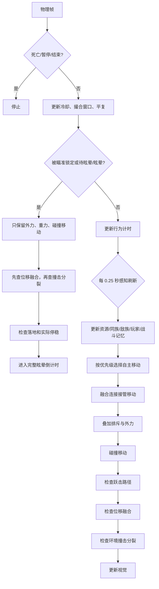
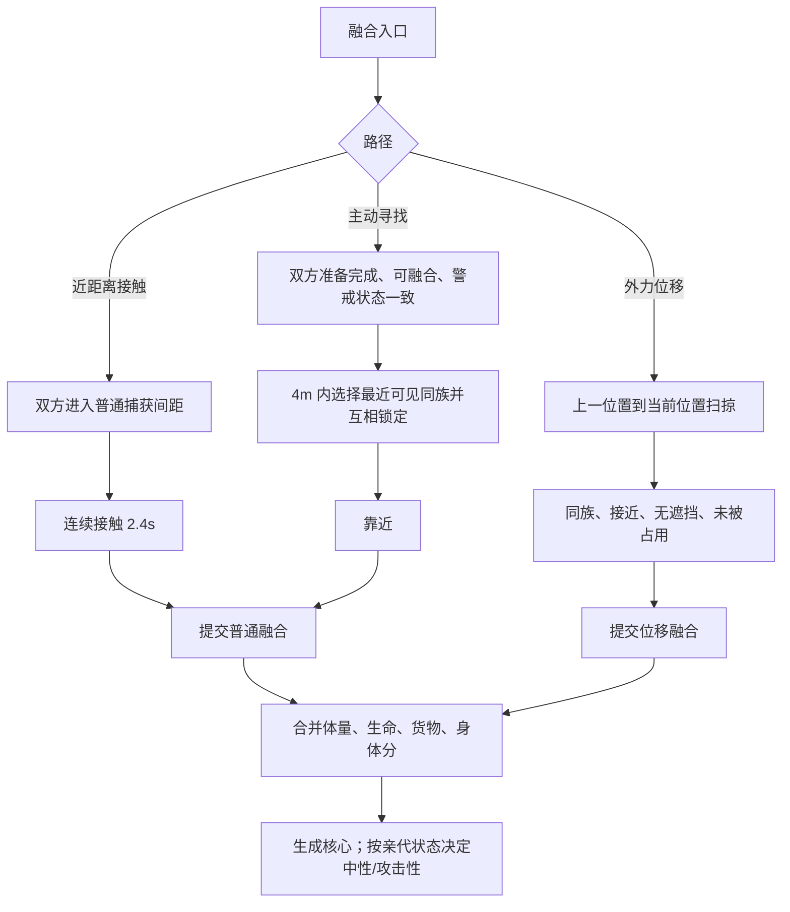
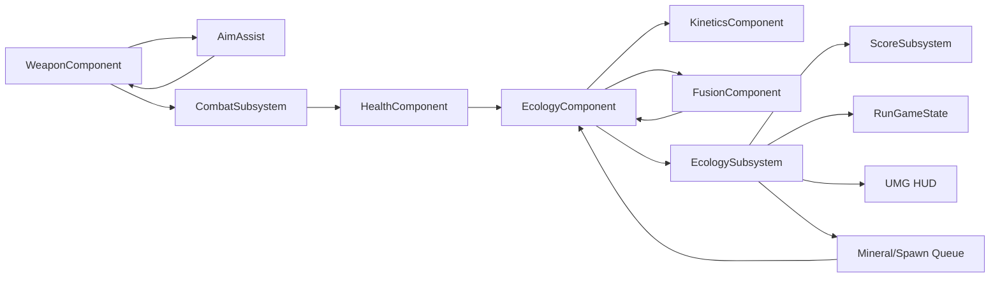

# Godot 11 → Unreal Engine 5.5 复刻拆解案

> 目标：把 `E:\UE\Unreal Projects\SlimeWar\11` 中可运行的 Godot 版本，拆成可在 UE 5.5 中实现的系统、数据、流程与验收标准。
>
> 依据：
> - Godot 导出工程 `11`（GDRE Tools 2.7.4 恢复）。
> - 最新策划案 `E:\UE\Unreal Projects\SlimeWar\策划案 (1)\策划案.md` 中 **“项目策划案V3”** 及其前面的 `10月9日机制补充案`。
> - 现有 UE 工程 `Source/SlimeWar`、`Content/_SlimeWar`、`Docs/ProgramTaskList.md`。
>
> 结论先行：`11` 的主场景是 `ecology_double_point.tscn`，实际玩法不是旧版“普通史莱姆 + 独立追兵 + 定时波次”，而是 **两阵营生态、个体自主采集/融合、融合产生核心、攻击性核心由融合和阵营冲突自然长出来**。最新 V3 文档与源码高度一致；旧策划案第 1～11 章中的部分规则已经被 V3 覆盖，不能直接照旧实现。

---

## 0. 阅读约定与证据等级

本文用三个等级区分信息来源：

| 标记 | 含义 | 使用场景 |
|---|---|---|
| **A：源码确定** | 在 Godot 恢复脚本或场景中能直接读到 | 数值、时序、状态转换、判定条件 |
| **D：策划目标** | 最新 V3 的明确设计意图 | 体验目标、规则解释、关卡意图 |
| **I：工程推断** | 为 UE 实现做的合理映射，尚需实机确认 | 类拆分、导航、性能方案、视觉替代 |

单位统一：

- Godot 使用 **米**；UE 使用 **厘米**。
- `UE_cm = Godot_m × 100`。
- Godot 默认前向为 `-Z`，UE 前向为 `+X`。建议的位置换算为：

```text
X_UE = -Z_godot × 100
Y_UE =  X_godot × 100
Z_UE =  Y_godot × 100
```

旋转不要直接复制 Godot 的欧拉角；应按换算后的三轴重建 `FRotator`。例如 Godot 中 `rotation.y = -60°` 的朝向，应在 UE 中验证为对应水平朝向，不能把 `-60` 直接塞进 Yaw。

---

## 1. 项目定位与目标体验

### 1.1 一句话定义

玩家是一名第三人称射击的“都市破坏者”，在城市白盒中击杀史莱姆、收集粘液，并通过射击、推挤和投掷物干预史莱姆的 **融合、运输和阵营冲突**，在倒计时结束前取得尽可能高的粘液成绩。

### 1.2 核心体验优先级

1. **射击收割反馈**：命中、击退、死亡、粘液喷溅、分数增长必须清楚。
2. **时机选择**：现在击杀小个体，还是等它们融合成高价值/高威胁核心。
3. **空间与资源取舍**：追攻击核心、截货、打断融合、换矿点、换射击位。

### 1.3 主题机制

不是“所有史莱姆追玩家”的怪海，而是：

- 普通个体在场景中自主觅食、融合、运输和争夺；
- 玩家可以击杀它们获得分数；
- 融合会消耗两个个体，产生更高生命、更高分值的核心；
- 玩家射击、身体推挤、蓄力击退可以改变融合和运输结果；
- 攻击性核心不是独立刷出的兵种，而是 **融合与阵营冲突的产物**；
- 玩家杀得越多，场上个体越少；玩家不杀，个体会继续融合、运输、繁殖。

---

## 2. Godot 11 的版本事实与场景边界

### 2.1 恢复结果

| 项目 | 结果 |
|---|---|
| 工程名 | `GJ TPS Lab` |
| 主场景 | `res://scenes/ecology_double_point.tscn` |
| 恢复工具报告 | 57 个脚本、72 个导入资源，全部恢复 |
| 引擎检测 | Godot **4.5.0**；`project.godot` 的 feature 字符串写有 `4.7` |
| 分辨率 | 1280 × 720，`canvas_items` 拉伸 |
| 渲染 | GL Compatibility |
| 资源形态 | 没有外部角色模型/音频；史莱姆、场地、喷溅、手榴弹基本由程序化 Mesh 生成 |

> 工程实现以恢复出的 4.5 脚本行为为准。`project.godot` 中的 `4.7` 更像是导出配置残留，不能据此假定存在 4.7 专属 API。

### 2.2 继承链

```text
Player
└─ player.gd

Arena
├─ arena.gd
│  └─ experiment_arena.gd
│     └─ timed_core_arena.gd
│        └─ ecology_arena.gd
│           ├─ ecology_building_level.gd（单点/双点主关卡）
│           └─ ecology_level.gd（60×50 三点关卡）

Slime
├─ slime.gd
│  └─ experiment_slime.gd
│     └─ ecology_slime.gd
```

这解释了为什么恢复代码里还保留 `timed_core_arena`、`experiment_*` 等旧实验逻辑。UE 复刻时应以 **最终 `ecology_*` 行为** 为准，只把旧层当作可复用的物理/表现工具，不能继承旧玩法规则。

### 2.3 当前实际流程

当前 `11` 是实验性可玩构建，加载主场景后直接进入局内：

- 没有标题菜单；
- 没有落点选择/投放演出；
- 没有旧版“每 20 秒一波”的定时生成；
- 按 `Esc` 暂停，按 `F5` 重开；
- `--start-paused` 是开发参数，会显示说明面板，但不是正式流程。

因此建议 UE 分两阶段：

1. **P0：复刻 `11` 的局内实验闭环**；
2. **P1：再接旧策划中的选点、投放、结算菜单**。

先做局内规则可以最快验证“融合—采集—攻击核心—计分”是否成立。

### 2.4 源码索引

| 原 Godot 文件 | 本拆解案对应内容 |
|---|---|
| `scripts/tuning.gd` | 全部调参字段、默认值 |
| `resources/ecology_*_tuning.tres` | 单点/双点/三点关卡的覆盖值 |
| `scripts/player.gd` | 移动、相机、射击、蓄力、身体推动 |
| `scripts/magnetic_weapon.gd` | 吸附、枪口射线、融合/分裂预测 |
| `scripts/weapon_preview.gd` | 屏幕预测线、锁定/蓄力 UI |
| `scripts/weapon_motion.gd` | 推力公式、阻尼、撞击分裂阈值 |
| `scripts/ecology_slime.gd` | 生态 AI、资源、核心、吞噬、攻击 |
| `scripts/experiment_slime.gd` | 融合连接、眩晕、外力撮合、核心转化 |
| `scripts/slime.gd` | 程序化外观、基础物理、生命 |
| `scripts/ecology_arena.gd` | 点位、矿点、货物、分数、手榴弹、回合 |
| `scripts/ecology_building_level.gd` | 双点/单点场景布局和导航参数 |
| `scripts/ecology_level.gd` | 三点大关卡布局 |
| `scripts/ecology_chart.gd` | F3 区域历史曲线 |
| `scripts/splat.gd` / `paint_field.gd` | 喷溅 Mesh、粘液画布 |
| `scripts/mineral_point.gd` | 矿点标记字段 |
| `scripts/mass_eight_weakpoint.gd` | 大体量弱点一击必杀 |
| `tests/ecology_*.gd` | 生态规则、资源、融合、攻击、关卡的回归测试 |

---

## 3. 主关卡：双点仓库

### 3.1 尺寸与坐标

主场景 `ecology_double_point.tscn`，根节点 `DoublePointWarehouse`，脚本为 `ecology_building_level.gd`，`point_count = 2`。

| 元素 | Godot 坐标/尺寸（米） | 说明 |
|---|---|---|
| 地板 | 中心 `(0,-0.5,0)`，尺寸 `44×1×30` | 可行走面在 `y=0` |
| 外墙 | 高 4.2，厚 0.35 | 不可穿透 |
| 三组分隔墙 | 中心 z = -12、0、12，尺寸 `0.3×3.4×6` | 把大厅切成多个通道 |
| 柱子 | x = ±17，z = ±10，`0.6×4.2×0.6` | 掩体和绕行点 |
| 货架 | x = ±12，z = ±9，`4×1.8×1` | 低掩体 |
| 玩家起点 | `(-18, 0.1, 11)`，朝向约 -60° | 面向场地中心 |
| A 点 | `(-14, 0, 1)` | 左阵营出生/交付中心 |
| B 点 | `(14, 0, 1)` | 右阵营出生/交付中心 |
| 区域 A 地面 | 中心 `(-14,0.012,1)`，`10×10` | 视觉分区 |
| 区域 B 地面 | 中心 `(14,0.012,1)`，`10×10` | 视觉分区 |
| 共享区地面 | 中心 `(0,0.012,0)`，`7×17` | 视觉共享区 |

白盒色板（Godot albedo，可直接作为 UE 材质初值）：

| 元素 | 颜色 |
|---|---|
| 地板 | `#394850` |
| 外墙 | `#687780` |
| 分隔墙 | `#73848B` |
| 柱子 | `#87949A` |
| 货架 | `#697A72` |
| A 区 | `#173F35` |
| B 区 | `#564027` |
| 共享区 | `#315867` |

三阵营颜色：

- A：`#55D9AC`（青绿）
- B：`#F2B85C`（橙黄）
- C：`#B59CFF`（紫）

环境背景为深蓝灰 `#111A29` 附近，环境光偏冷，主方向光从 `(-55°,-30°)` 照射并开阴影。UE 复刻时优先保留“冷色地面 + 高饱和阵营色 + 黄色弱点”的辨识关系。

### 3.2 矿点

| 矿点 | 坐标 | 初始库存 | 再生 |
|---|---:|---:|---|
| WestNear | `(-7, 0.08, -5)` | 4 | 否 |
| EastNear | `(7, 0.08, 5)` | 4 | 否 |
| SouthShared | `(0, 0.08, -6)` | 5 | 是，上限 6，每 5 秒 +1 |
| NorthShared | `(0, 0.08, 6)` | 5 | 是，上限 6，每 5 秒 +1 |

初始总库存为 18 份；共享矿点可以缓慢再生成到 6 份，但只有被消耗后才会继续再生。

### 3.3 单点版本

`ecology_single_point.tscn` 使用同一套脚本：

| 元素 | 数值 |
|---|---|
| 场地 | 30×22 米 |
| 玩家起点 | `(-12,0.1,8)` |
| A 点 | `(-9,0,1)` |
| 矿点 | `(-5,-3)` 库存 4；`(3,0)` 库存 5、再生；`(8,3)` 库存 4、再生 |
| 目标 | 120 秒，65 分 |
| 初始体量 | 10 |

### 3.4 三点关卡

`ecology_level.tscn` / `ecology_level.gd`：

- 60×50 米；
- 三个点：A `(-13,0,10)`、B `(13,0,10)`、C `(0,0,-15)`；
- 初始每点 10 体量，共 30；
- 五个矿点：三点附近各一，中心两个共享点；
- 180 秒，160 分；
- 中心争夺区判定为 `|x| < 8 && |z| < 7`。

### 3.5 导航与可通行性

Godot 没有使用 NavMesh，而是自定义格点流场：

| 场景 | 格点原点 | 格点步长 | 格点尺寸 |
|---|---|---:|---|
| 单点 | `(-12,-8)` | 1.0 米 | `27×19` |
| 双点 | `(-20,-13)` | 1.0 米 | `41×27` |
| 三点 | `(-28,-23)` | 1.5 米 | `39×32` |

导航步骤：

1. 每个格点用半径 1.1 米的球体检查静态碰撞，保留可站立格；
2. 如果身体中心到目标的直线路径穿过墙体，则从目标格点向四邻域做 BFS；
3. 当前格点选择距离更小的相邻格点；
4. 移动时用“中心线 + 身体左右偏移线”检查遮挡。

UE 首选 `NavMesh` + `Detour Crowd`；但要保留以下验收条件：

- 大体量史莱姆不能穿墙；
- 同一阵营的运输路线能绕过分隔墙；
- 三个点/两个点都能走到所有矿点；
- 追攻击核心不能隔墙扣血，不能瞬移；
- 被堵住时可以重试或绕行，不能永久卡死。

---

## 4. 玩家系统

### 4.1 输入

| 动作 | 键位 |
|---|---|
| 移动 | W/A/S/D |
| 冲刺 | Shift |
| 跳跃 | Space |
| 射击/蓄力 | 鼠标左键按住，松开 |
| 瞄准减速 | 鼠标右键按住 |
| 换肩 | Q |
| 换弹 | R |
| 暂停 | Esc |
| 重开 | F5 |
| 选择同化/旋风 | 1 / 2 |
| 选择阵营 A/B/C | Z / X / C |
| 投掷手榴弹 | G |

### 4.2 移动、相机与生命

| 属性 | 当前值 |
|---|---:|
| 步行速度 | 6 m/s |
| 冲刺速度 | 9 m/s |
| 瞄准速度 | 3 m/s |
| 水平加速度 | 20 m/s² |
| 跳跃初速度 | 7 m/s |
| 重力 | 20 m/s² |
| 相机距离 | 4 m |
| 瞄准距离 | 2.2 m |
| 常态/瞄准 FOV | 75° / 55° |
| 鼠标灵敏度 | 0.0025 rad/px |
| 玩家碰撞半径 | 0.43 m（身体推动开启时）；否则 0.35 m |
| 玩家碰撞高度 | 1.8 m |
| 生命 | 100 |
| 受击保护 | 0.6 s |
| 弹药 | 3 发弹匣，无限备弹 |

实现要点：

- `aim_speed` 优先于 `sprint_speed`；
- 相机弹簧臂只和静态世界碰撞，碰墙收缩；
- 空中仍可受重力，只有落地可跳；
- 玩家不能穿透墙体和大型史莱姆；
- 受击只闪烁、方向反馈和短震屏，不长期锁操作；
- 结束、暂停、死亡时清空速度并禁止射击/伤害。
- 没有被动回血，也没有局内恢复物；生命只能通过避免受击和受击保护维持。

### 4.3 射击与蓄力

| 属性 | 当前值 |
|---|---:|
| 普通伤害 | 8 |
| 射击间隔 | 0.22 s |
| 射程 | 18 m |
| 弹匣 | 3 |
| 换弹 | 1.0 s |
| 蓄力开始有效区 | 按住 > 0.18 s |
| 满蓄力时间 | 1.2 s |
| 满蓄力半径 | 4 m |
| 满蓄力击退速度 | 14 m/s |
| 普通射击推力 | 4 / `mass^0.65`，水平 |
| 外力阻尼 | 5 m/s² |

蓄力公式：

```text
s = clamp((holdTime - 0.18) / (1.20 - 0.18), 0, 1)
damage = 8 × (1 - s)
pushRadius = 4 × s
radialPushSpeed = 14 × s × (1 - 0.4 × distance / pushRadius)
```

关键行为：

- 短按最多 0.18 秒，等价于普通射击；
- 满蓄力直接伤害为 0，但仍可产生范围击退；
- 普通射击命中的目标会额外受到 `4 / mass^0.65` 的直接推力；
- 范围击退只作用于史莱姆组，且从弹着点到目标中心必须没有静态遮挡；
- 冲击速度达到 6 m/s 且体量 ≥2 时，打开 0.9 秒的撞击分裂窗口；
- 范围击退与直接射击推力可以叠加。

### 4.4 枪口射线与遮挡

发射流程（A：源码确定）：

1. 从相机中心射线得到瞄准点；
2. 如果有吸附目标，瞄准点改为目标身体中心或弱点；
3. 从相机到瞄准点先做一次遮挡检查；
4. 从枪口再向目标做一次实际命中射线；
5. 命中第一个墙体或目标后停止；
6. 目标必须实现 `take_damage` 或 `receive_shot`；
7. 墙体命中不算 `hit`，墙后的目标不能被击中；
8. 没有穿透、没有爆炸伤害；死亡喷溅只作表现。

UE 实现建议：

- `USlimeWeaponComponent::SolveShot()` 返回 `FSlimeShotSolution`：
  - `AimPoint`
  - `MuzzleEnd`
  - `HitResult`
  - `TargetActor`
  - `bWeakpoint`
- 使用 `LineTraceSingleByChannel`，从相机和枪口各做一次；
- 使用 `IgnoreActorWhenMoving` 处理自身碰撞；
- 不要在动画蓝图里生成真正的抛射物，当前是瞬时命中。

### 4.5 磁性瞄准与预测线

Godot 版本的“磁性瞄准”不是自动瞄准射击，而是“准星附近的屏幕空间辅助吸附”：

- 捕获半径 = 视口高度 × 0.1；720p 下为 72 px；
- 已锁定目标的保留半径 = 捕获半径 × 1.35；
- 新目标必须在屏幕距离上小于原目标的 55%，才会换锁；
- 目标必须在 18 m 射程内；
- 相机到目标、枪口到目标都必须无遮挡；
- 目标屏幕投影必须在捕获圆内；
- 锁定目标只停止其 **自主移动**，外力、重力、碰撞仍然生效；
- 锁定目标为体量 >6 时，可分别选择身体中心或黄色弱点；
- 瞄准屏幕射线与枪口射线共用同一套击中判定。

UE 实现：

- `USlimeAimAssistComponent` 在每帧/每 0.05 秒扫描 `Slime` 目标；
- 用 `UWidgetLayoutLibrary::ProjectWorldLocationToWidgetPosition` 或等价投影；
- 缓存 `LockedTarget` 与 `bLockedWeakpoint`；
- 预测线由 `USlimeWeaponComponent` 计算，UMG 绘制；
- 预览必须显示：
  - 目标圈；
  - 蓄力环；
  - 预计移动轨迹；
  - 预计融合点；
  - 预计撞击分裂；
  - 弱点必杀提示；
  - “锁定 · 轻推 / 蓄力 %”文字。

### 4.6 身体推动

开启身体推动后：

- 玩家胶囊半径 0.43 m；
- 只推动体量 1～3 的史莱姆；
- 推动不耗弹、不造成伤害；
- 推速基础 2.6 m/s，加速度 18 m/s²；
- 推速还受玩家移动速度、碰撞法线和史莱姆体量修正；
- 被推动的史莱姆会获得 0.2 秒身体推动标记，并开启 3 秒玩家撮合窗口；
- 体量 4 以上是实体障碍，玩家应被挡住，不能挤穿。

UE 实现不要只依赖 `AddImpulse`：

- 在玩家移动后检查 `SlideCollision`；
- 对每个触碰史莱姆调用 `UPhysicsHandle` 或自定义 `ApplyExternalPush`；
- 同时写入 `ExternalVelocity` 和 `ForcedFusionWindow`；
- 体量阈值必须读数据，不能写死在 C++。

---

## 5. 史莱姆实体模型

### 5.1 体量、生命、大小与分数

Godot 使用体量 1～8：

```text
health = mass × 30
radius = (0.22 + 0.38 × (mass - 1) / 7) × 1.8
```

主关卡数据：

| 体量 | 最大生命 | 碰撞半径 m | 普通身体分 | 攻击性身体分 | 可推动 | 弱点 |
|---:|---:|---:|---:|---:|---|---|
| 1 | 30 | 0.396 | 4 | 2 | 是 | 无 |
| 2 | 60 | 0.494 | 8 | 4 | 是 | 无 |
| 3 | 90 | 0.591 | 13 | 6 | 是 | 无 |
| 4 | 120 | 0.689 | 20 | 10 | 否 | 无 |
| 5 | 150 | 0.787 | 29 | 14 | 否 | 无 |
| 6 | 180 | 0.885 | 40 | 20 | 否 | 无 |
| 7 | 210 | 0.982 | 53 | 26 | 否 | 有 |
| 8 | 240 | 1.080 | 68 | 34 | 否 | 有 |

注意：策划文档中经常引用“直径”，而源码的 `size_radius()` 返回半径。UE 中建议在数据表字段名明确写 `BodyRadius`，不要使用含糊的 `Size`。

### 5.2 视觉组成

Godot 史莱姆是程序化组合体：

- 主体半透明球，使用 `slime.gdshader`；
- 内部深色核心球；
- 两只白眼球和黑色瞳孔；
- 左上高光球；
- 体量 ≥7 时顶部生成黄色弱点球；
- 融合时生成双方之间的桥接球；
- 攻击性核心增加两侧尖刺；
- 标签显示 `体量 | 生命`，靠近、携货、蓄力、融合、警戒时显示行为文本。

Shader 关键参数：

- 顶点 `sin(VERTEX.y×13 + time×6)` 的横向抖动；
- `wobble` 约 `0.015 + moving×0.015`，融合时额外增加；
- 边缘光 `pow(1 - dot(normal, view), 2.5)`；
- 半透明 `alpha = 0.38 + rim×0.42`；
- 粗糙度 0.13，高光 0.8，边缘有弱自发光。

UE 替代方案（I）：

- 用 `Sphere` + 透明、边缘光材质；
- 用材质参数 `Wobble`、`RimPower`、`JellyColor`；
- 组件化生成眼球、核心、弱点、尖刺，避免 8 套模型；
- 视觉半径按体量表插值，碰撞半径单独由数据表控制。

### 5.3 碰撞与分组

Godot 碰撞层：

| 层 | 用途 |
|---:|---|
| 1 | 世界/墙/地面 |
| 2 | 玩家 |
| 4 | 史莱姆主体 |
| 8 | 大体量史莱姆附加层 |

实际规则：

- 史莱姆始终在世界层和玩家层中处理；
- 体量 ≥3 会获得第 8 层；
- 玩家层与史莱姆层互相碰撞；
- 射线/瞄准检查 `1 | 4`，并允许命中 Area（弱点）；
- 不能让玩家被大体量史莱姆永久卡死，也不能让史莱姆穿墙。

UE 建议：

- 保留独立的 `SlimeBody` 和 `SlimeWeakpoint` 对象通道；
- 用 `FSlimeCollisionProfile` 集中定义：
  - `SlimeBody`
  - `SlimeLargeBody`
  - `SlimeWeakpoint`
  - `Player`
  - `WorldStatic`
- 不要在多个蓝图里散落碰撞响应。

---

## 6. 行为系统：每帧优先级

### 6.1 物理帧总流程



关键语义：

- **被瞄准锁定** 和 **待眩晕/眩晕** 共用“只保留外力”的分支；
- 锁定只停止自主行动，不阻止外力、重力、碰撞和融合；
- 眩晕必须先在落地且实际位移速度 ≤0.1 m/s 的状态下稳定 0.1 秒，才开始计时；
- 分裂平复期间不能接收警戒、不能自主融合、不能被玩家撮合；
- 眩晕期间分裂平复不消耗，只有瞄准锁定期间仍可消耗（源码的例外）。

### 6.2 自主行动优先级

按源码从上到下：

| 顺序 | 条件 | 行为 |
|---:|---|---|
| 1 | 攻击性核心处于前摇/跃击 | 继续攻击 |
| 2 | 受惊/身体推动恢复 | 原地等待，保留外力 |
| 3 | 携货 | 先避让玩家，再避开敌对核心，否则返程 |
| 4 | 攻击性核心空载且无战斗/苏醒/脱离 | 有资源目标则采集，否则进入攻击行为 |
| 5 | 普通个体处于首次警戒预警 | 原地等待预警结束 |
| 6 | 附近有敌对核心 | 选择可走退路 |
| 7 | 玩家进入避让范围 | 远离玩家 |
| 8 | 无伙伴、无警戒、可采集 | 回收散落货物或前往矿点 |
| 9 | 采集休息期间看到粘液 | 靠近粘液并停留 |
| 10 | 已有融合伙伴 | 暂停自主移动，交给融合连接 |
| 11 | 警戒中看见敌族 | 远离敌族 |
| 12 | 警戒中看见同族 | 向同族靠近 |
| 13 | 以上都不满足 | 探索附近 |

### 6.3 感知频率与范围

| 项目 | 当前值 |
|---|---:|
| 感知刷新间隔 | 0.25 s |
| 同族感知 | 7 m，要求存活、行为启用、同阵营、无遮挡 |
| 归群开始/解除 | >2.8 m / <1.8 m |
| 普通竞争者感知 | 6 m |
| 攻击性核心敌族感知 | 9 m（6×1.5） |
| 玩家战斗感知 | 6 m，另查视线 |
| 资源/掉落货物感知 | 8 m，查遮挡 |
| 资源记忆 | 28 s |
| 玩家避让进入/解除 | 2.4 m / 3.2 m，另查高度和遮挡 |
| 普通回避速度 | 1.1 m/s |
| 危险退避速度 | 1.54 m/s |
| 个体额外间距 | 0.25 m |
| 间距排斥系数 | 3 |
| 粘液感知 | 6 m |
| 粘液趋近速度 | 0.65 m/s |
| 资源探索半径 | 6～10 m |
| 无资源探索选点时间 | 12 s |
| 有资源记忆探索半径 | 3～6 m |
| 探索速度 | 1.15 m/s（无资源记忆）/0.9 m/s |
| 探索候选数 | 12 |
| 探索到达距离 | 0.7 m |
| 重复探索格 | 4 m，每次访问扣 5 分 |

### 6.4 归群与避让

- 同族参照不是“跟随队长”，只用于确定归群方向；
- 没有可见同族时，个体在 `home_position` 周围游荡；
- 超过活动区会先回家，再考虑融合；
- 玩家靠近时先选择“远离玩家、道路可走、周围不拥挤”的退路；
- 退路从正后、左右 45°、左右 90° 共 5 个方向评分；
- 墙体、不可站立位置先排除，再按远离程度和拥挤度选择；
- 玩家离开解除距离后，恢复粘液/群体/探索目标。

### 6.5 警戒与阵营冲突

最新 V3 修正了旧机制：

- **玩家枪击不创建、不刷新、不传播普通警戒**；
- 只有敌族实际造成伤害、或看见资源争夺条件满足时，才会触发普通警戒；
- 首次接收警戒有 1 秒预警，预警期间原地等待；
- 警戒持续 10 秒；
- 5 米内、无遮挡、同阵营的个体可以接收；
- 不接力传播；
- 警戒不会把单只普通个体直接变成攻击性核心；
- 必须在警戒期间完成一次合格融合，才会生成攻击性核心；
- 已有攻击性核心被玩家击中，会记录短时 `player_provoked = 6s`，允许它把玩家纳入战斗目标；
- 普通个体被玩家击中只打断动作、推动、延迟眩晕，不产生仇恨。

争夺条件（A）：

- 看见 3.4 m 内的敌族；
- 且自己已有矿点目标/携货，或敌族携货，或敌族是攻击性核心；
- 连续累计 1.5 秒；
- 触发一次后 5 秒冷却；
- 触发时向 5 米内可见同族发送警戒；
- 玩家不在此传播链中。

---

## 7. 采集、运输与交付

### 7.1 自动采集流程

当前 `11` 中没有固定“收集队编制”，也没有 `timed_core_arena` 的自动选 2 名采集者逻辑。实际是 **每只史莱姆根据自身观察自主决定**：

1. 每 0.25 秒观察 8 米内可见矿点；
2. 看到有库存的矿点则写入记忆，记忆 28 秒；
3. 没有货物、没有伙伴、没有警戒、采集休息结束时，选择矿点；
4. 选点时按距离 + 同族拥挤代价（可见个体距矿点 <1.4 m，每只 +1.8）；
5. 目标锁定 2 秒，减少频繁切换；
6. 靠近矿点 1.2 m 内开始采集；
7. 采集 2 秒，且结算时仍在 1.3 m 内、有遮挡检查、有库存，则库存 -1、货物 +1；
8. 携货后返程，交付距离 1.3 m；
9. 交付后清空货物、在所属阵营生成 1 只体量 1 个体、初始体量/供给 +1；
10. 交付后随机 2～4 秒采集休息。

### 7.2 资源守恒

一次完整结算应满足：

```text
矿点库存
+ 地面上散落货物
+ 存活个体携带货物
+ 已交付货物
+ 已截获货物
= 初始库存 + 已再生库存
```

Godot 用 `resource_balance()` 做自动化测试；UE 应该把它做成开发期断言或调试面板，而不是只靠肉眼。

### 7.3 散落货物

- NPC 击杀或吞噬时，如果受害者有货物，会在死亡位置生成一个货物箱；
- 箱子内部可以是数量 >1，但每次拾取只转移 1 份；
- 拾取距离 1.1 m，且无遮挡；
- 拾取后个体 `cargo += 1`；
- 有货物的个体不参与普通自主融合（旋风造成的例外见后文）。

### 7.4 再生矿点

- 只有 `regenerates = true` 的矿点再生；
- 每 5 秒 +1；
- 上限 6；
- 单点/双点/三点场景均使用这个规则；
- 再生只增加库存，不直接生成史莱姆；
- 只有实际采集并交付，才增加 1 只个体。

### 7.5 交付生成

交付不会走旧版“有限储备扣减”：

- 每交付 1 份，`total_supply += 1`；
- `reserved_supply[site] += 1`；
- 向该阵营的 `pending_spawns` 队列加入 1 个请求；
- 生成位置按阵营中心周围的环尝试，避开玩家 2.7 m 和已有个体；
- 每帧最多处理 8 个生成请求；
- 位置不合法时保留请求并重试；
- 回合结束清空队列。

UE 建议让 `USlimeEcologySubsystem` 独占这个队列，不要把生成请求散落在每个史莱姆或 `ASpawnPoint` 上。

---

## 8. 融合系统

### 8.1 三条进入路径



### 8.2 自主融合

普通自主融合：

- 只与同阵营个体；
- 双方合计体量 **最多 2**；
- 双方必须有可融合资格；
- 双方警戒状态一致；
- 4 米内互相可见；
- 双方没有其他伙伴；
- 主动寻伴超时 10 秒；
- 靠近速度 0.75 m/s；
- 接触判定距离 = 双方半径 + 0.18 m；
- 稳定接触 2.4 秒后提交；
- 完成融合后双方进入 1.8 秒融合冷却；
- 新个体出生弹跳 0.65 秒；
- 新个体不能立即继续主动融合。

自主融合准备时间：

- 初始随机 14～22 秒；
- 警戒可以跳过准备时间（但不能跳过分裂平复、眩晕等保护）；
- 被打断后双方获得 5 秒主动融合禁用；
- 玩家仍可在 5 秒内通过合格位移撮合强制融合。

### 8.3 位移/玩家撮合

以下行为开启 3 秒 `forced_fusion_left`：

- 玩家射击命中；
- 玩家身体推动；
- 玩家蓄力范围击退；
- 被外力推动的任何合格小体量个体。

判定：

- 同阵营；
- 总质量 ≤8；
- 不是处于分裂平复；
- 不是眩晕/待眩晕保护中的不可撮合对象；
- 两个个体在上一位置到当前位置的扫掠路径上发生接近；
- 扫掠距离 ≤ 双方半径 + 0.08 m（撮合）或 +0.18 m（普通接触）；
- 双方没有其他伙伴；
- 中心线无遮挡；
- 通过后立即合并，不等待 2.4 秒。

重要边界：

- 玩家撮合可以突破“自主最多 2 体量”的上限，最高到 8；
- 玩家射击会设置 0.8 秒融合冷却，但撮合窗口会保留“受击前是否已满足融合冷却”的快照，避免本次射击的冷却阻止撮合；
- 旧冷却未结束时仍不能强行撮合；
- 分裂平复优先于所有撮合；
- 旋风只提供短暂“可融合”资格，不直接添加玩家撮合标记。

### 8.4 融合结果

```text
newMass = a.mass + b.mass             // 上限 8
newHealth = a.health + b.health       // 新最大生命 = newMass×30
newCargo = a.cargo + b.cargo
newBodyScoreCredit = full(a) + full(b)
coreArmed = true
hostile = a.core_hostile || b.core_hostile || a.agitation > 0 || b.agitation > 0
```

- 普通融合通常生成 **中性核心**；
- 警戒中的个体融合、或任一方原本是攻击性核心，生成 **攻击性核心**；
- 攻击性核心分值减半；
- 核心被玩家击杀时会爆裂；
- 中性核心被玩家击杀时也爆裂，但按完整分计分；
- 融合本身不增加击杀数、不产生击杀分数；
- 融合保留伤害、货物、身体分，不自动补满。

### 8.5 当前“自主最多 2 体量”的原因

`ecology_slime.can_fuse_with()` 的实际判定是：

```text
same site
and (
    mass + other.mass <= 2
    or self.core_hostile
    or other.core_hostile
)
```

但因为攻击性核心通常 `is_mobile_core()` 为真，而 `fusion_available()` 对移动核心返回 false，所以攻击性核心不会自己继续找伙伴融合。结果是：

- 普通个体自然融合最多形成体量 2；
- 大体量主要通过玩家撮合、吞噬、分裂后重组产生；
- 不要把这个上限误写成总融合上限 2；总量上限始终是 8。

---

## 9. 受击、眩晕与撞击分裂

### 9.1 受击流程

玩家普通射击命中：

1. 取消当前融合连接；
2. 双方获得 5 秒主动融合禁用；
3. 设置 0.8 秒融合冷却；
4. 添加普通射击推力；
5. 打开 3 秒玩家撮合窗口；
6. 保存待眩晕 1.5 秒；
7. 等个体落地并实际停稳后，才开始眩晕；
8. 若已经有更长的待眩晕/剩余眩晕，取最大值，不叠加。

### 9.2 停稳判定

- 必须在地面；
- 实际位移速度 ≤0.1 m/s；
- 连续满足 0.1 秒；
- 才把 `stun_pending` 转成 `stun_left`；
- 转移时清空残余外力；
- 如果被墙挡住，实际位移已为 0，也应视为停稳，不必等力值自然衰减；
- 空中碎片不会提前消耗眩晕；
- 眩晕期间再次受击，先取消当前眩晕计时，把新值和旧值取最大，重新等待停稳。

### 9.3 撞击分裂

触发条件：

- 受到范围击退，冲击速度 ≥6 m/s；
- 体量 ≥2；
- 0.9 秒窗口内；
- 侧向撞到静态环境（墙体、道具等）；
- 撞到玩家、其他史莱姆、地面不触发。

结果：

- 预先寻找足够数量的合法位置；
- 每个碎片体量 1；
- 碎片数 = 父体量；
- 生命平分；
- 货物逐份分配，余数给前几个碎片；
- 身体分按完整分预算分配，避免分合刷分；
- 碎片清空攻击性、警戒、目标和旧刺激；
- 碎片保留 5 秒分裂平复；
- 碎片 2.5 秒融合冷却；
- 停稳后眩晕 2 秒；
- 位置不足则整次分裂不提交，不丢失体量。

>
> 当前 `ecology_slime` 关闭了“拥挤压力自动分裂”（`allows_pressure_split() = false`）。拥挤只会推动/排斥，不会因人多自动分裂。不要把旧实验版的压力分裂带回正式生态。

---

## 10. 攻击性核心

### 10.1 生成与识别

攻击性核心需要同时满足：

- `core_armed == true`
- `core_hostile == true`
- `mobile_cores == true`

攻击性核心的视觉：

- 顶部/侧面尖刺；
- 黄色/橙红色标签；
- 核心苏醒 1.2 秒；
- 可跃击；
- 分值减半；
- 可吞噬敌族成长。

### 10.2 战斗目标

- 战斗记忆 6 秒；
- 追击速度 3.8 m/s；
- 追离交战起点 15 m（单点）/19 m（双点）；
- 失去视线后追最后可见位置，不读墙后玩家实时位置；
- 生命低于 30% 且看见威胁时，清除战斗、退避/回出生点；
- 脱离交战 2.5 秒；
- 携货时优先返程；
- 空载且无战斗时可以去采集；
- 与玩家距离 <2.4 m，或已有玩家受击刺激记忆时，可把玩家作为目标；
- 玩家距离 <1.8 m 时优先覆盖敌族目标；
- 更远时优先可见敌族。

### 10.3 跃击

| 属性 | 当前值 |
|---|---:|
| 基础跃击距离 | 3.4 m |
| 苏醒 | 1.2 s |
| 前摇 | 0.65 s |
| 攻击间隔 | 1.6 s |
| 收势 | 0.4 s |
| 冲刺速度 | 10.5 m/s |
| 冲刺时长 | 0.4 s |
| 起跳向上速度 | 3 m/s |
| 对玩家伤害 | 20 |
| 对敌族伤害 | 16 |
| 命中高度差 | ≤1.4 m |
| 对同一目标重复命中 | 每次跃击最多一次 |
| 脱离交战 | 2.5 s |

流程：

1. 视野内、距离在 `max(3.4, size_radius+0.65)` 内；
2. 进入前摇，锁定水平方向；
3. 前摇结束立即设置 `pounce_direction`、`pounce_left=0.4`、向上速度 3；
4. 每帧按上一位置到当前位置的线段检查沿途敌族/玩家；
5. 同一目标在一次跃击中只命中一次；
6. 目标中途消失也沿原方向完成冲刺；
7. 跃击结束后进入收势和冷却；
8. 眩晕/受击可以取消前摇或冲刺。

### 10.4 吞噬

只有攻击性移动核心可以吞噬：

- 对敌族造成致死伤害；
- 伤害来源必须是 NPC 攻击，不是玩家；
- 吸收量 = `min(受害者体量, 8 - 攻击者体量)`；
- 超出部分记为 waste；
- 保留攻击者货物；
- 受害者货物掉落；
- 新个体体量 = 攻击者体量 + 吸收量；
- 新生命 = `min(新最大生命, 原生命 + 吸收量×15)`；
- 新身体分 = 攻击者完整分 + 按比例继承受害者完整分；
- 新个体仍为攻击性核心；
- 吞噬不给玩家被动分。

---

## 11. 核心爆裂、连锁与得分

### 11.1 爆裂

玩家击杀带核心的个体时，核心进入爆裂队列：

```text
radius = 3.0 + mass × 0.25     // 单位：米
```

| 体量 | 半径 |
|---:|---:|
| 1 | 3.25 m |
| 2 | 3.50 m |
| 4 | 4.00 m |
| 6 | 4.50 m |
| 8 | 5.00 m |

效果：

- 来源核心死亡并结算一次；
- 爆炸范围内的其他核心直接递归进入连锁；
- 普通史莱姆受到 `42 × lerp(1.0, 0.65, distance/radius)` 伤害；
- 普通史莱姆获得 8 / `mass^0.45` 的径向推力；
- 有静态遮挡则不伤害、不推动；
- 爆裂伤害中心 42，边缘约 27.3；
- 连锁爆炸每只只结算一次；
- 来源和连锁受害者都按各自完整分/攻击性减半规则计分；
- 死亡喷溅只作表现，不额外伤害。

### 11.2 分数公式

主关卡：

```text
bodyScore(mass) = mass × 4 + max(mass - 2, 0)²
fullBodyScore   = max(bodyScore, inheritedBodyScore)
fullScore       = fullBodyScore + cargo × 6
hostileScore    = floor(fullScore × 0.5)
```

例：

| 体量 | 身体分 | 携货 2 份完整分 | 攻击性得分 |
|---:|---:|---:|---:|
| 1 | 4 | 16 | 8 |
| 2 | 8 | 20 | 10 |
| 4 | 20 | 32 | 16 |
| 6 | 40 | 52 | 26 |
| 8 | 68 | 80 | 40 |

得分规则：

- 只有玩家击杀才加分；
- NPC 互杀不加玩家分；
- NPC 被玩家击杀后，其货物的 6 分/份并入玩家得分；
- 玩家击杀攻击性核心时按减半分计算；
- 玩家击杀中性核心时按完整分计算；
- NPC 击杀掉落货物，玩家之后拾取再交付，不会直接得分；交付只增员；
- 已死亡对象不会重复结算；
- 分裂/融合时用 `body_score_credit` 保留完整分，反复分合不重复增值；
- 玩家先射击、后来被 NPC 击杀，不能算玩家击杀；本次致死来源决定归属。

### 11.3 弱点

- 体量 1～6：没有弱点；
- 体量 7～8：顶部生成黄色弱点；
- 弱点是一个独立 Area，半径约 0.28 m，位置在身体上方；
- 任何正伤害命中弱点，直接造成 `host.health` 伤害，触发击杀；
- 0 伤害（满蓄力）不会触发弱点击杀；
- 玩家瞄准可以分别选择身体或弱点；
- 弱点击杀按正常身体分/攻击性减半计分；
- 攻击性核心没有额外“只能打身体”的保护：体量 7～8 仍有弱点；
- 分裂后碎片为体量 1，弱点消失。

---

## 12. 手榴弹

### 12.1 共同参数

| 属性 | 当前值 |
|---|---:|
| 同化/旋风初始数量 | 各 3 |
| 投掷间隔 | 0.7 s |
| 初速度 | 准星方向 13 m/s + 向上 4 m/s |
| 重力 | 20 m/s² |
| 最长飞行 | 2 s |
| 碰到环境 | 立即触发 |

### 12.2 同化手榴弹

- 半径 4.5 m；
- 当前只检查距离，不检查墙体遮挡；
- 范围内所有不同阵营个体改为所选阵营；
- 改变颜色；
- 取消融合关系；
- 清除战斗目标、资源记忆、警戒、采集状态；
- 不直接扣血；
- 不受阵营数量限制；
- 当前构建中不对玩家造成伤害。

### 12.3 旋风手榴弹

- 半径 6 m；
- 持续 4.5 s；
- 对范围内、行为启用、无遮挡的个体持续吸引；
- 吸引加速度 12 m/s²；
- 速度上限 4.5 m/s；
- 中心 0.2 m 内停止吸引；
- 不直接造成伤害；
- 短暂设置 `vortex_left = 0.35s`、`fusion_help_left = 0.4s`；
- 让携货个体在旋风期间也具备融合资格；
- 实际合并仍走位移融合检查，不会自动合并。

---

## 13. 回合、结算与数据记录

### 13.1 各版本数值

| 场景 | 时长 | 目标分 | 点位数 | 初始体量 | 矿点 | 备注 |
|---|---:|---:|---:|---:|---|---|
| 单点 `ecology_single_point` | 120 s | 65 | 1 | 10 | 3 | 车间 |
| 双点 `ecology_double_point` | 150 s | 200 | 2 | 20 | 4 | 主场景 |
| 三点 `ecology_level` | 180 s | 160 | 3 | 30 | 5 | 大关卡 |

### 13.2 结束条件

只有三种结束：

1. 时间耗尽；
2. 玩家生命归零；
3. 场上所有个体消失且没有待生成供给（灭绝）。

达到目标分 **不会提前结束**，只显示里程碑提示。

`Esc` 暂停必须同时冻结：倒计时、AI 决策与移动、融合计时、警戒/眩晕、生成、手榴弹、伤害、玩家射击。F3/F4 调试面板可以在暂停时打开，但不能恢复模拟。

### 13.3 结算判定

```text
passed = not died
      && player.health > 0
      && score >= goal_score
```

- 死亡时失败，即使分数达标；
- 灭绝时也进行同样的通过判定，菜单标题显示“群落全部消失 · 挑战通过/未达标”；
- 通过且分数高于最佳时保存最佳；
- 失败不刷新最佳；
- 结算后停止生成、融合、攻击和新增得分；
- 重试重新加载场景，清空所有状态。

### 13.4 需要保存的状态

最低限度：

- 本局得分；
- 目标分；
- 最佳分；
- 存活/死亡；
- 用时；
- 玩家射击次数；
- 玩家击杀数；
- NPC 击杀数；
- 融合次数；
- 爆裂/连锁次数；
- 截获货物/交付货物；
- 初始/生成/剩余/移除体量；
- 阵营分数；
- 区域历史采样（2 秒一次）；
- 事件日志（上限 4096 条）。

Godot 最终写入 `user://ecology_last_round.json`，最佳分写入 `user://ecology_best.cfg`。UE 可用 `USaveGame` 或 `SaveGame` 子系统保存最佳分，调试用 JSON 可走 `FJsonSerializer`。

---

## 14. 表现、UI 与反馈

### 14.1 HUD

当前 HUD 是代码生成的简单文字界面：

- 左上：标题、得分/目标、击杀数；
- 右上：倒计时；
- 底部：生命、弹药、换弹、融合/爆裂/连锁、货物、手榴弹；
- 中上：消息提示；
- 屏幕中心：准星；
- 目标附近：体量、生命、行为、融合进度、载货、警戒；
- 矿点：名称、库存、再生状态；
- 阵营点：A/B/C、交付数量、增员数量；
- 按 F3：区域走势图；
- 按 F4：每只史莱姆当前分数调试。

UE 建议：

- HUD 用 UMG，保留信息层级但不要照搬所有文字；
- 世界标签用池化 WidgetComponent，按距离/状态显示；
- 不要把 `Label3D` 的每帧字符串拼接直接搬进 UE；
- 准星/锁定/蓄力/预测线放在同一个瞄准层，避免多个 Widget 抢焦点。

### 14.2 粘液痕迹

Godot 的喷溅不是普通 Decal：

- 每只死亡生成 `Splat`，用 SurfaceTool 画不规则粘液形状；
- 随后 `experiment_arena` 把粘液写入 640×544 的 `ImageTexture`；
- 贴图覆盖整个场地，shader 读取 RGBA 并进行噪声扰动；
- 场景只显示一张 `PlaneMesh`，旧 Splat Mesh 被隐藏；
- 每 256 个 Splat 释放最老的 Mesh，但贴图像素不会回滚；
- 结果是一张整局累积的“战场画布”。

UE 复刻建议（I）：

1. 用 Runtime Virtual Texture / Canvas Render Target 保存颜色和 alpha；
2. 用材质笔刷或 `DrawMaterialToRenderTarget` 在死亡点写入颜色；
3. 用一个贴地平面或 RVT 采样显示；
4. 不采用 256 个独立 Decal，否则性能和排序都不可控；
5. 结算俯瞰时保留粘液，不因镜头切换销毁。

### 14.3 临时反馈

| 反馈 | 时长/规则 |
|---|---|
| 枪线 | 0.07 s |
| 命中闪色 | 0.15 s |
| 受击闪屏 | 0.35 s |
| 伤害红屏 | 0.6 s |
| 死亡分数弹字 | 0.8 s |
| 爆裂环 | 0.55 s |
| 粘液落地缩放 | 0.22 s |
| 出生弹跳 | 0.65 s |
| 融合接触视觉 | 双体桥接 + 形变 |
| 眩晕星星 | 眩晕期间旋转 |

### 14.4 音频

`11` 的恢复结果中 **没有 AudioStream、Sound 或音频调用**。音频不是当前版本的已实现内容，UE 复刻不能把“已有音效”当作前提。若要补音频，应把它作为表现层的后续新增，并为射击、命中、融合、眩晕、爆裂、拾取分别定义事件。

---

## 15. 数据资产设计

### 15.1 总原则

现有 UE 工程已经明确“数值只放 DataTable/DataAsset，不写 C++ 魔法数”。Godot 11 的数值很多是 `TPSTuning` 默认值 + 每关 `.tres` 覆盖值。复刻时应拆成：

- **全局武器/玩家表**：跨关卡一致；
- **史莱姆体量表**：跨关卡一致；
- **生态规则表**：警戒、融合、资源、核心；
- **关卡数据资产**：点位、矿点、玩家起点、时长、目标分；
- **运行时状态**：不能进入资产。

### 15.2 建议的 UE 资产

| UE 资产 | 承载内容 | 来源 |
|---|---|---|
| `DA_Weapon_Rifle` | 伤害、射速、弹匣、换弹、射程、蓄力、瞄准吸附 | `default_tuning.tres` + V3 |
| `DT_SlimeMassTiers` | 体量 1～8 的生命、半径、基础分、弱点、视觉参数 | `tuning.gd` + V3 表 |
| `DA_EcologyRules` | 感知、资源、警戒、融合、眩晕、核心、手榴弹 | `tuning.gd` 的 Ecology/Experiment 段 |
| `DA_Level_SinglePoint` | 30×22、1 点、3 矿点、120/65 | `ecology_single_point.tscn/tres` |
| `DA_Level_DoublePoint` | 44×30、2 点、4 矿点、150/200 | `ecology_double_point.tscn/tres` |
| `DA_Level_ThreePoint` | 60×50、3 点、5 矿点、180/160 | `ecology_level.tscn/tres` |
| `BP_SlimeEcology` | 视觉、碰撞、行为组件组装 | 程序化 Mesh 的替代 |
| `BP_SlimeMineralPatch` | 库存、再生、标签、占位 | `mineral_point.gd` |
| `BP_SlimeSite` | 阵营、出生/交付中心、生成队列 | 场景 Marker |
| `WBP_AimPreview` | 瞄准、蓄力、轨迹预测 | `weapon_preview.gd` |

### 15.3 必要字段清单

**玩家/武器**

- `WalkSpeed`、`SprintSpeed`、`AimSpeed`
- `Acceleration`、`Gravity`、`JumpSpeed`
- `PlayerRadius`、`PlayerHeight`
- `MaxHealth`、`HitProtection`
- `CameraDistance`、`AimDistance`、`NormalFOV`、`AimFOV`
- `MouseSensitivity`
- `Damage`、`FireInterval`、`MagazineSize`、`ReloadTime`、`ShotRange`
- `ChargeStart`、`ChargeSeconds`、`ChargePushRadius`、`ChargePushSpeed`
- `DirectShotPushSpeed`
- `AimCaptureRatio`、`AimRetentionRatio`、`AimSwitchRatio`
- `BodyPushMaxMass`、`BodyPushSpeed`、`BodyPushAcceleration`

**史莱姆体量**

- `Mass`
- `MaxHealth`
- `BodyRadius`
- `BodyScore`
- `WeakpointStartMass`
- `Mesh/VFXScale`

**生态规则**

- `InitialMassPerSite`
- `BodyScorePerMass`
- `LargeMassBonus`
- `CargoScore`
- `ResourceSenseRange`
- `ResourceMemory`
- `ResourceRegrowSeconds`
- `SharedResourceCapacity`
- `DisputeRange`、`DisputeSeconds`、`DisputeCooldown`
- `AlertRange`、`AlertWarning`、`AlertDuration`
- `FusionContactTime`、`FusionCooldown`
- `FusionSeekRange`、`FusionSeekSpeed`、`FusionSeekTimeout`
- `FusionRestMin/Max`
- `FusionCaptureGap`、`FusionContactGap`、`FusionInfluenceTime`
- `InterruptedFusionBlock`
- `ForcedFusionWindow`、`ForcedFusionGap`
- `HitStun`、`SplitStun`、`SplitCalm`
- `StunStopSpeed`、`StunSettleTime`
- `ImpactSplitSpeed`、`ImpactWindow`
- `CoreWake`、`CoreChaseSpeed`、`CoreSense`、`CoreMemory`
- `CoreAttackRange`、`CoreWindup`、`CoreRecovery`、`CoreAttackInterval`
- `CoreDamagePlayer`、`CoreDamageRival`
- `PounceRange`、`PounceSpeed`、`PounceDuration`、`PounceLift`
- `LeashDistance`、`RetreatHealth`
- `DevourMaxMass`、`DevourHealPerMass`

**关卡**

- `SiteId`、`Faction`、`SiteLocation`
- `InitialMass`
- `PatchLocation`、`InitialStock`、`bRegenerates`、`DisplayName`
- `RoundSeconds`、`GoalScore`
- `PlayerStart`
- `Bounds`
- `SpawnSlots` / 安全生成环
- `PaintWorldSize`

### 15.4 现有 UE 数据结构的改造建议

现有 `FSlimeStatRow` 已有 `MaxHealth/MoveSpeed/BodyRadius/KillScore/Mesh`，方向正确，但还缺：

- `EcologyBodyScore`
- `WeakpointStartMass`
- `FactionDefaultColor`

现有 `FWeaponStatRow` 还缺：

- `ChargeWeapon`
- `ChargeSeconds`
- `ChargeStart`
- `ChargePushRadius`
- `ChargePushSpeed`
- `DirectShotPushSpeed`
- `AimCaptureRatio`
- `AimRetentionRatio`
- `AimSwitchRatio`

现有 `USlimeRunConfig` 可以继续作为“关卡/回合配置”，但建议新增 `USlimeEcologyRules`，避免把 70 多个生态参数硬塞进一个已经很大的 DataAsset。

---

## 16. UE 5.5 架构落点

### 16.1 当前 UE 工程已有的可复用资产

| 现有类 | 复刻用途 | 需要改造 |
|---|---|---|
| `ASlimeWarCharacter` | 玩家移动、相机、GAS 生命 | 增加蓄力、瞄准吸附、身体推动 |
| `USlimeWeaponComponent` | 射速、弹匣、换弹、伤害 | 增加 `SolveShot`、预测线、满蓄力零伤害 |
| `ASlimeEnemyBase` | 史莱姆表现/生命/物理 | 增加生态状态、阵营、货物、核心 |
| `USlimeFusionComponent` | 现有融合配对 | 扩展位移撮合、5 秒打断、2.4 秒接触、1.8 秒冷却 |
| `USlimeHealthComponent` | 敌人生命 | 加入伤害来源和身体分继承 |
| `USlimeStateComponent` | 状态标签 | 增加警戒、眩晕、载货、核心、平复 |
| `URunSubsystem` | 倒计时、开始/结束 | 增加灭绝结束、目标不提前结束 |
| `UScoreSubsystem` | 分数/最佳 | 增加体量分、货物分、减半、NPC 击杀不计分 |
| `USlimeEnemyManagerSubsystem` | 存活统计 | 增加体量守恒、资源守恒、阵营统计 |
| `ASpawnPoint` | 出生/点位 | 改为生态点，不再驱动旧批量波次 |
| `USlimeAIController` | AI 导航 | 改为生态行为优先级/StateTree |
| `USlimeStateTreeAIComponent` | 状态树 | 保留巡逻/采集/融合等状态能力 |
| `USlimeHUDWidget` | HUD | 增加资源、货物、手榴弹、区域图 |

### 16.2 推荐新增组件

```text
USlimeEcologySubsystem (WorldSubsystem)
├─ 管点/矿点/阵营/生成队列
├─ 资源守恒与体量守恒
├─ 交付、增员、阵营分数
└─ 回合事件与采样

ASlimeMineralPatch (Actor)
├─ Stock
├─ bRegenerates
├─ RegrowTimer
└─ 交互/可见性

USlimeEcologyComponent (ActorComponent)
├─ Faction
├─ Cargo
├─ BodyScoreCredit
├─ ResourceTarget / DroppedTarget
├─ Rival / CombatTarget
├─ GroupAnchor / HomePosition
└─ 行为计时

USlimeKineticsComponent (ActorComponent)
├─ ExternalVelocity
├─ StunPending / StunLeft
├─ ForcedFusionWindow
├─ ImpactSplitWindow
├─ Pressure / BodyPush
└─ 停稳检测

USlimeEcologyBrain (StateTree/AI 组件)
├─ 观察与记忆
├─ 自主行为优先级
├─ 返回群体/探索/躲避
└─ 融合/采集/攻击选择

USlimeAimAssistComponent
├─ LockedTarget / LockedWeakpoint
├─ 屏幕捕获
└─ 预览解算

USlimePaintSubsystem
├─ RenderTarget/RVT
├─ 死亡喷溅写入
└─ 结算保留

ASlimeGrenade
├─ Assimilation
└─ Tornado
```

### 16.3 建议的运行时数据流



### 16.4 与现有旧架构的差异

这是本复刻案最重要的迁移提醒：

| 旧 UE 方案 | Godot 11 / V3 实际 |
|---|---|
| `ETargetKind::Normal / Aggressive` 两类独立单位 | 普通个体、中性核心、攻击性核心是同一套个体的状态 |
| 攻击性个体独立生成 | 攻击性核心由融合/吞噬/冲突产生 |
| 每点每批 8 普通 + 2 攻击，6 批 | 固定初始体量 + 资源交付 1:1 增员 |
| 普通个体只在本点活动 | 普通个体围绕点位，但可跨区域采集/追击 |
| 追兵不融合、不成长 | 攻击性核心由核心状态决定，可吞噬成长 |
| 融合接触 0.4 秒、上限 8 | 自动寻伴最多 2 体量，接触 2.4 秒；玩家撮合可到 8 |
| 攻击性个体无收益 | 攻击性核心按完整分减半计分 |
| 当前 UE 武器无蓄力/无瞄准吸附 | 蓄力满伤害为 0、范围击退、屏幕吸附 |
| 当前 UE `ERunEndReason` 只有时间/死亡 | 还需要 `Extinction` |
| 当前 UE 的生成点负责批量刷怪 | 生态子系统负责矿点、货物、交付、生成队列 |

如果直接在现有 `ASpawnPoint`/`ASlimeNormal`/`ASlimeAggro` 上加零散 if，最终会把“生态规则”分散到三个系统。建议：

- 保留 `ASlimeEnemyBase` 作为生命/物理/表现基类；
- 把旧 `Normal/Aggro` 的职责迁移为 `EcologyRole` + `CoreState`；
- 在 `USlimeEcologySubsystem` 统一管理站点和矿点；
- 在 `USlimeEcologyComponent` 统一管理个体生态状态；
- 让旧 `ASpawnPoint` 只保留“出生位置/队列入口”能力，不再强行承载生态规则。

---

## 17. UE 实现路线

### 17.1 P0：可玩的生态灰盒

目标：用一张双点场景验证完整闭环，不接标题/投放。

1. `ASlimeWarCharacter` 支持 6/9/3 移动、跳跃、相机、生命；
2. `USlimeWeaponComponent` 支持 3 发弹匣、1 秒换弹、0.22 秒射击间隔、瞬时射线；
3. `USlimeEcologySubsystem` 建立 A/B 两个站点和 4 个矿点；
4. 30 只初始个体（2×10 等）通过安全队列生成；
5. 个体能移动、避墙、观察矿点、采集、返程、交付；
6. 交付后生成 1 只体量 1；
7. 普通个体可以自然融合成中性体量 2 核心；
8. 玩家射击可打断融合、推动、延迟眩晕；
9. 击杀中性核心爆裂并给分；
10. 倒计时结束进入结算。

**退出条件**：一局能稳定跑 150 秒；资源守恒和体量守恒无报警；没有永久卡死。

### 17.2 P1：规则完整

- 攻击性核心由警戒融合产生；
- 敌对核心跃击、追离、退避；
- 吞噬、货物掉落、拾取；
- 撞击分裂、碎片位置预检、分数继承；
- 体量 7/8 弱点；
- 同化/旋风手榴弹；
- 分数减半、NPC 击杀不计分、最佳分保存。

**退出条件**：V3 的“核对项”全部有自动化/手动测试记录。

### 17.3 P2：表现与关卡

- 粘液 RenderTarget/RVT；
- 世界标签池化；
- 蓄力/轨迹/融合/分裂预测线；
- 三个关卡布局；
- 结算俯瞰镜头；
- 调试 F3/F4 等价面板。

### 17.4 P3：正式流程

- 从旧策划接入选点/投放；
- 投放期间冻结生成、融合、攻击、伤害；
- 落地后 0.5 秒解锁镜头；
- 结算菜单与重试；
- 失败成绩与最佳分分离。

---

## 18. 验收测试矩阵

最好把 Godot 自动化测试平移为 UE Automation Test（`IMPLEMENT_SIMPLE_AUTOMATION_TEST`）。至少覆盖：

| 测试组 | 断言 |
|---|---|
| 玩家移动 | 步行 6、冲刺 9、瞄准 3；跳跃 7；碰撞不穿墙 |
| 射击 | 3 发后自动换弹；R 提前换弹；枪口被墙挡不能命中 |
| 蓄力 | 满蓄力伤害 0、半径 4、速度 14；短按 ≤0.18 s 为普通射击 |
| 吸附 | 目标屏距在捕获圈内；换锁需小于 55%；锁定目标自主停下但外力有效 |
| 融合-自然 | 2 个体量 1 形成体量 2 中性核心；不能继续自动到 3 |
| 融合-强制 | 玩家射击/推挤可形成体量 3+；总量不超过 8；跨阵营拒绝 |
| 融合-生命 | 受伤融合保留剩余生命；货物和身体分不丢 |
| 融合-打断 | 射击打断双方；5 秒主动禁用；玩家撮合仍可 |
| 眩晕 | 滑行时不启动；停稳后 1.5 秒；分裂 2 秒；重复命中刷新不叠加 |
| 分裂 | 体量 2 可碎成 2；体量 8 碎成 8；位置不足不提交；货物/分数守恒 |
| 计分 | 体量 8 无货 68；携货 2 完整 80；攻击性 40；NPC 击杀 0 |
| 核心 | 玩家击杀核心爆裂；连锁只算一次；墙后不伤害 |
| 弱点 | 体量 1～6 无；体量 7/8 有；0 伤害不触发；正伤害必杀 |
| 资源 | 采 1 份、交付 1 份、生成 1 只；再生上限 6；库存/货物守恒 |
| 警戒 | 玩家射击不传播；敌族伤害传播；5 米内可见同族；10 秒衰减 |
| 攻击核心 | 前摇锁方向；离开范围落空；同一次跃击同一目标只命中一次 |
| 吞噬 | 攻击核心吃掉敌族；最多到 8；保留自身货物；不给玩家分 |
| 手榴弹 | 同化改变阵营并清警戒；旋风吸引且不自动融合 |
| 回合 | 目标分不结束；时间到结算；死亡失败；灭绝可结束 |
| 重试 | 分数、货物、队列、事件、历史全部清零 |

### 18.1 推荐平移的 Godot 测试

- `ecology_rule_update.gd`：1.5/2 秒眩晕、200 分、自动融合上限 2；
- `collision_score_rules.gd`：身体推动融合、半分、碎片完整分；
- `stun_after_stop.gd`：待眩晕/停稳/墙/暂停；
- `aim_placement_smoke.gd`：瞄准停止、外力、轻/重射击融合、预览；
- `autonomous_fusion_smoke.gd`：主动寻伴、遮挡、超时、暂停；
- `group_alert_smoke.gd`：击杀射击不传播、敌族攻击传播、核心转化；
- `interrupted_fusion_smoke.gd`：5 秒打断、玩家撮合例外；
- `ecology_grenade_smoke.gd`：同化、旋风、两体量碎裂；
- `ecology_smoke.gd`：运输、暂停、阵营/个体调试、核心伤害、吞噬；
- `resource_smoke.gd`：实际采集/返程/库存/货物继承；
- `mass_eight_weakpoint_smoke.gd`：体量 7/8 弱点、满蓄力 0 伤害；
- `ecology_building_layout.gd`：单/双点布局、矿点连通、1:1 增员；
- `ecology_building_round.gd`：资源/体量长期守恒；
- `player_shot_neutrality.gd`：玩家射击不制造普通仇恨；
- `body_behaviour_smoke.gd`：群体、避让、身体推动、堵墙；
- `ecology_round.gd`：长时间观察/干预两种模式。

---

## 19. 风险、待确认与边界

### 19.1 已确认的源码事实

- `11` 是实验构建，不是完整正式版；
- 没有音频资源；
- 没有外部角色美术资源；
- 主场景没有选点/投放；
- 自动融合最多 2 体量；
- 攻击性核心由融合/冲突产生，不独立刷；
- 交付 1 份资源只生成 1 只体量 1；
- 玩家射击不触发普通警戒；
- 撞击分裂只碰静态环境；
- 体量 1～6 没有弱点，7/8 有；
- 满蓄力直接伤害为 0；
- 目标分达到后不提前结束。

### 19.2 仍需 UE 实机确认

1. **UE CharacterMovement 与自定义外力**：Godot 的 `impulse` 与 UE `CharacterMovement` 的速度/加速度模型不同，必须统一“外力速度”和“自主速度”的叠加顺序，否则眩晕停稳、撞击分裂、融合扫掠判定会对不上。
2. **导航**：Godot 的自定义格点流场和 UE NavMesh 可能在大体量半径、墙体拐角、队列拥堵上表现不同。需要用双点/三点布局做路线验收。
3. **碰撞层与弱点 Area**：UE 的 `LineTrace` 对 `Area` 的响应、弱点和身体的选择顺序需要单独验证，避免弱点遮挡身体。
4. **粘液 RenderTarget**：UE 的 RVT/Canvas 写入需要处理投影、gamma、透明度和结算保留；不能用普通 Decal 简单替代。
5. **性能**：Godot 每只史莱姆做 O(N²) 邻居扫描；UE 需要空间哈希或管理器分组，避免 30～60 只时每帧全表扫描。
6. **确定性**：当前随机种子固定（竞技场 20261014/20261015），UE 若用 `FMath::Rand` 要注意种子、Physics Substep 和多线程；复刻验收应优先保证规则正确，再看随机序列是否一致。

### 19.3 不建议直接沿用旧文档的内容

以下旧章节规则已被 Godot 11 / V3 覆盖：

- 独立“普通 + 追兵”两种敌人；
- 每 20 秒一波、每批 8 普通 + 2 追兵；
- 融合接触 0.4 秒；
- 普通个体只在本点活动、不参与资源；
- 攻击性个体完全无分数；
- 右键瞄准只减速、不提供吸附；
- 玩家射击会使普通个体警戒；
- 目标分达到后立即结算。

旧文档仍可作为“世界观、选点流程、结算镜头、美术方向”的参考，但不能作为局内规则的最终依据。

---

## 20. 一页式复刻清单

### 必做

- [ ] 双点 44×30 白盒和 A/B 两阵营；
- [ ] 玩家 6/9/3 移动、跳跃、TPS 相机；
- [ ] 3 发弹匣、1 秒换弹、8 伤害、18 米瞬时射线；
- [ ] 0.18 秒起蓄、1.2 秒满蓄、满蓄 0 伤害 + 4 米击退；
- [ ] 屏幕吸附、身体/弱点选择、锁定停止自主移动；
- [ ] 玩家射击推力、身体推动、3 秒撮合窗口；
- [ ] 史莱姆体量 1～8、生命 30×体量、分值公式；
- [ ] 自动采集、返程、交付、1:1 增员；
- [ ] 共享矿点 6 上限、5 秒再生；
- [ ] 普通融合最多 2 体量、2.4 秒接触、1.8 秒冷却；
- [ ] 玩家强制融合到 8、5 秒打断禁用；
- [ ] 眩晕必须停稳后计时、命中 1.5 秒/分裂 2 秒；
- [ ] 撞墙分裂、5 秒平复、分数/货物守恒；
- [ ] 警戒、阵营争夺、攻击性核心；
- [ ] 跃击、吞噬、爆裂、连锁；
- [ ] 体量 7/8 弱点；
- [ ] 同化/旋风手榴弹；
- [ ] 150 秒/200 分、时间/死亡/灭绝结算；
- [ ] 粘液痕迹和结算俯瞰；
- [ ] 自动化测试覆盖本文章节 18。

### 不应该做

- [ ] 不要继续用“独立追兵刷新”作为攻击核心来源；
- [ ] 不要让玩家射击直接让普通个体仇恨玩家；
- [ ] 不要把攻击性核心做成完全不产分的独立兵种；
- [ ] 不要用 0.4 秒接触融合覆盖当前的 2.4 秒；
- [ ] 不要用“每 20 秒一批”替代资源交付增员；
- [ ] 不要把满蓄力当成高伤害攻击；
- [ ] 不要把体量 8 的黄色弱点当成所有体量通用；
- [ ] 不要把压力拥挤自动分裂带回正式生态；
- [ ] 不要把 NPC 击杀、玩家之前的非致死射击算成玩家得分。

---

## 21. 附：Godot 11 主场景资源坐标速查

### 双点主场景

```text
场地：44 × 30 m
玩家：(-18, 0.1, 11)
A 点：(-14, 0, 1)
B 点：( 14, 0, 1)

矿点：
  WestNear     (-7, -5)  库存 4  不再生
  EastNear     ( 7,  5)  库存 4  不再生
  SouthShared  ( 0, -6)  库存 5  再生
  NorthShared  ( 0,  6)  库存 5  再生

共享区地面：x ∈ [-3.5, 3.5]（视觉矩形 7×17）
```

### 单点场景

```text
场地：30 × 22 m
玩家：(-12, 0.1, 8)
A 点：(-9, 0, 1)
矿点：(-5,-3) 4； (3,0) 5/再生； (8,3) 4/再生
```

### 三点场景

```text
场地：60 × 50 m
玩家：(-22, 0.1, 18)
A：(-13, 0, 10)
B：( 13, 0, 10)
C：(  0, 0,-15)
中心争夺区：|x| < 8 且 |z| < 7
矿点：A/B/C 附近各 1 个 + 中心 2 个共享点
```

---

## 22. 结论

复刻的正确顺序不是“先做敌人 AI，再补资源”，而是：

1. **先把个体物性和外力/停稳/融合窗口做对**；
2. **再把采集和 1:1 交付增员接上**；
3. **再让警戒和融合自然产生攻击性核心**；
4. **最后接分数、表现、结算和正式流程**。

只要前 3 步中任何一步用旧版“普通/追兵/波次”逻辑替代，后续的攻击核心、分数减半、资源守恒和玩家干预都会失真。建议以本文第 18 节的验收矩阵作为 UE 移植的合并门槛，而不是只看一局能否运行。

