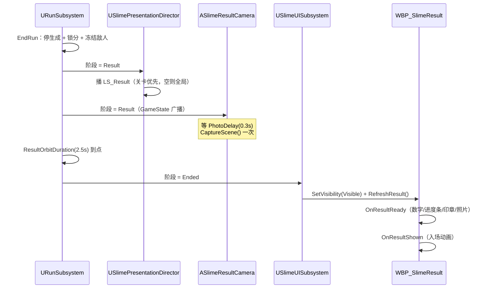

# 结算页实现方案（WBP_SlimeResult）

> 目标：把结算页从“能显示”做到“数据对、进度条对、按钮能用、背景是一张真照片”。
> 范围：`USlimeResultWidget` / `USlimeUISubsystem` / `USlimeGameSettings` / 新增 `ASlimeResultCamera` / `WBP_SlimeResult` / 关卡里的拍照相机与材质。
> 依据：`Docs/PhaseD/PhaseD-Plan.md` PD-10 / PD-11、`Docs/UI/UI_Blueprint_Interface_Guide.md` §5.2、`Docs/PhaseD/PhaseD-AssetGuide（UI指南.md` §2.3、`Docs/UI/USlimeHUDWidget改动记录.md` §二。
> 阅读顺序：先看 §0 的清单，再按 §3 的顺序执行；C++ 部分可直接照抄，WBP 部分是连线步骤。

---

## 0. 未完成清单（记录用，做完一项勾一项）

状态约定：`未开始` / `进行中` / `已完成` / `待确认`（待确认项不阻塞 C++ 与 WBP，可先按默认值做）。

### 0.1 C++

| 编号 | 事项 | 文件 | 前置 | 状态 |
|---|---|---|---|---|
| C-01 | 新增拍照 Actor `ASlimeResultCamera`（Camera + SceneCapture + 运行时 RT） | `Public/UI/SlimeResultCamera.h`（新）/ `Private/UI/SlimeResultCamera.cpp`（新） | 无 | 未开始 |
| C-02 | 结算控件新增 `GetResultPhoto()` | `Public/UI/SlimeResultWidget.h` / `.cpp` | C-01 | 未开始 |
| C-03 | 结算控件新增 `OnResultShown` 事件，且只在阶段 = Ended 时触发 | 同上 | 无 | 未开始 |
| C-04 | 结算控件新增 `HasNextLevel()` / `RequestNextLevel()` / `RequestLevelSelect()` 转发 | 同上 | C-05 | 未开始 |
| C-05 | UI 子系统新增 `RequestLevelSelect()` / `RequestNextLevel()` / `HasNextLevel()` / `GetCurrentLevelIndex()` | `Public/UI/SlimeUISubsystem.h` / `.cpp` | C-06 | 未开始 |
| C-06 | 设置类新增 `IndexOfLevel(FName)` | `Public/GameplayFramework/SlimeGameSettings.h` / `.cpp` | 无 | 未开始 |

### 0.2 编辑器资产

| 编号 | 事项 | 资产/位置 | 前置 | 状态 |
|---|---|---|---|---|
| A-01 | 在关卡里摆一个 `SlimeResultCamera`，机位对齐 `LS_Result` 末帧，尺寸 1024×640 | `L_Whitebox_CityPlaza` | C-01 编译通过 | 未开始 |
| A-02 | 新建 UI 材质 `M_ResultPhoto`（参数名 `Photo`） | `Content/_SlimeWar/UI/Materials/` | 无 | 未开始 |
| A-03 | 第二关的 `DA_Level_*` 与 `Levels` 配置（“下一关”按钮才会解锁） | `Config/DefaultGame.ini` + 数据资产 | 无 | 未开始 |
| A-04 | 确认本关 `DA_RunConfig::ResultOrbitDuration` = 序列长度（当前 2.5） | `DA_RunConfig` | 无 | 未开始 |

### 0.3 WBP

| 编号 | 事项 | 控件/事件 | 前置 | 状态 |
|---|---|---|---|---|
| W-01 | `OnResultReady` 填五个数字（得分/最高分/目标分/清点数/击杀数） | `Text_*` | 无（事件已存在） | 未开始 |
| W-02 | 分数进度条两段（蓝 = 得分/目标分，黄 = 超出/150） | `Bar_Blue` / `Bar_Yellow` | W-01 | 未开始 |
| W-03 | 达标 / 未达标印章 | `Img_Stamp` + `T_Stamp_Passed` / `T_Stamp_NotPassed` | W-01 | 未开始 |
| W-04 | 三个按钮：重新开始 / 下一关 / 选择关卡，并处理“下一关”不可用 | `Btn_Restart` / `Btn_NextLevel` / `Btn_SelectLevel` | C-04 | 未开始 |
| W-05 | 照片显示：`Img_Photo` + 动态材质 + 无照片时回退 `T_Result_BG` | `Img_Photo` | C-02、A-02 | 未开始 |
| W-06 | 入场动画挂到 `OnResultShown`，不要挂 `OnResultReady` | 动画轨道 | C-03 | 未开始 |

### 0.4 验收与待确认

| 编号 | 事项 | 说明 | 状态 |
|---|---|---|---|
| V-01 | 进度条采样验证（0 / 300 / 375 / 450） | 见 §7 | 未开始 |
| V-02 | 无相机、单关卡、死亡超分、重试残留四条边界 | 见 §7 | 未开始 |
| Q-01 | “清点数”是出生点清空数还是史莱姆数 | 默认按 `ClearedPoints`（0~3 个点位）实现 | 待确认 |
| Q-02 | “击杀总数”是否包含追兵（Aggressive） | 默认按 `NormalKills`（只算普通）实现 | 待确认 |
| Q-03 | 最高分是否显示 `Max(Score, BestScore)` | 默认显示原始 `BestScore`（只在过关时刷新） | 待确认 |

---

## 1. 已定方案与待确认项

### 1.1 已定（本次按此实现）

| 决策 | 结论 |
|---|---|
| 进度条 | 沿用局内 WBP 的两段式：蓝 = `Score / TargetScore`，黄 = `(Score - TargetScore) / 150`，150 继续写死在蓝图里 |
| 下一关 | 落到**下一关的准备页**，不直接开局（各关 `DropPoints` 数量可能不同，落点索引不能跨关沿用） |
| 选择关卡 | 直接切到选关页，**不重载世界**；不要复用 `RequestQuit()`（那个是回主菜单 + 重载世界） |
| 结算照片 | 方案 A：关卡里放一个静态 `ASlimeResultCamera`（SceneCapture2D + RenderTarget），`Result` 阶段拍一次；`LS_Result` 保持 Spawnable 不动 |
| 拍照时机 | `Result` 广播后延迟 `PhotoDelay = 0.3s` 拍，避开死亡溶解/喷溅的半截动画；`Ended` 时若还没拍过则补拍一次兜底 |
| 数据时机 | 结算数值只在 `Ended` 是最终值，一律在 `OnResultReady` 里写；`OnResultShown` 只用于播动画 |

### 1.2 待确认（不阻塞开发）

- **Q-01 清点数**：`FSlimeRunResult::ClearedPoints` 是“清空的出生点个数”（`ScoreSubsystem.cpp:80-89`），不是史莱姆个数。若策划要的是“清掉的史莱姆数”，需在 `UScoreSubsystem` 另加计数器。
- **Q-02 击杀总数**：`AddKill()` 对 `Aggressive` 直接 return（`ScoreSubsystem.cpp:40-45`），追兵击杀不计数。要含追兵需加 `TotalKills` 并改 `FSlimeRunResult`。
- **Q-03 最高分**：`ResolveBestScore()` 只在“时间到且达标”时刷新（`ScoreSubsystem.cpp:106-120`）。玩家 400 分但死亡时，界面上的最高分可能是旧值甚至 0。三种处理任选：原样显示 / 显示 `Max(Score, BestScore)` / 在未过关时加一行“本局未计入最高分”。

---

## 2. 数据来源与时序

### 2.1 结算页能读到的字段

`OnResultReady(Result)` 的 `Result` 就是 `FSlimeRunResult`（`RunSubsystem.h:22-47`），来源链路：

```text
UScoreSubsystem（GameInstance，跨重试保留最佳分）
        ↓ PullSnapshot / 委托
ASlimeRunGameState
        ↓ GetRunResult()
URunSubsystem（组装 + bPassed 规则）
        ↓
USlimeResultWidget::RefreshResult() → OnResultReady(Result)
```

| 界面元素 | 字段 | 说明 |
|---|---|---|
| 最终得分 | `Result.Score` | 已锁分（`LockScoring`），最终值 |
| 最高分 | `Result.BestScore` | 见 Q-03 |
| 目标分 | `Result.TargetScore` | **不要写死 300**，来自本关 `RunConfig` |
| 清点数 | `Result.ClearedPoints` | 出生点清空数，0~3 |
| 击杀数 | `Result.NormalKills` | 只算普通史莱姆 |
| 达标 / 未达标 | `Result.bPassed` | `TimeUp && Score >= Target`，死亡一律 false |
| 结束原因 | `Result.EndReason` | `TimeUp` / `PlayerDied`，可用于文案区分 |

> `WasPassed()` 也能用，但它会再查一次 GameState；WBP 里直接用 `Result.bPassed` 更直接。

### 2.2 阶段时序（照片为什么来得及）



**关键点**：Result → Ended 之间有 2.5s，照片在这段时间里一定已经渲染完成，结算页不会闪黑。

### 2.3 `OnResultReady` 会被调用两次（必须知道）

`NativeConstruct()` 里也调了 `RefreshResult()`（`SlimeResultWidget.cpp:9-14`），而控件是**关卡开始时就创建**的，所以：

| 调用时机 | 数据 | 后果 |
|---|---|---|
| 关卡开始（Construct） | 全 0（`BeginRun` 还没跑） | 数字被写成 0，但页面此时是 Collapsed，看不见 |
| 结算显示（Ended） | 最终值 | 正常覆盖 |

所以：**数字直接覆盖写没问题；入场动画/音效绝对不能挂在 `OnResultReady`**，否则动画在关卡开始时就播完了，结算页出现时不会再播。这就是 C-03 新增 `OnResultShown` 的原因。

---

## 3. 执行顺序（总览）

```text
第 1 步  C-06 → C-01 → C-02 → C-03 → C-05 → C-04
         （先写设置类与拍照 Actor，再写控件与子系统；最后补控件转发）
第 2 步  编译（关掉编辑器再编译，否则 DLL 被占用）
第 3 步  打开编辑器：A-01 摆相机 → A-02 建材质
第 4 步  WBP：W-01 数字 → W-02 进度条 → W-03 印章 → W-04 按钮 → W-05 照片 → W-06 动画
第 5 步  V-01 / V-02 验收
```

为什么这个顺序：

- **C++ 必须在 WBP 之前**：`Get Result Photo` / `Has Next Level` 这些节点只有编译通过后才会出现在蓝图里。
- **A-01 必须在 W-05 之前**：没有相机就没有 RT，`GetResultPhoto()` 永远返回 null，只能验证兜底分支。
- **WBP 内部按“数据 → 表现 → 交互”排**：先让数字对，再做进度条（依赖数字），最后接按钮（依赖 C++ 动作）。

---

## 4. C++ 部分

### 4.1 C-06 设置类：按 LevelId 找下标

`USlimeGameSettings` 已有 `FindLevelByIndex` / `FindLevelById`（`SlimeGameSettings.cpp:7-36`），缺“按 ID 找下标”——“下一关”要靠它 +1。

`Public/GameplayFramework/SlimeGameSettings.h`，加在 `FindLevelById` 后面：

```cpp
	/** Level id -> index in Levels; INDEX_NONE when the id is empty or unknown. */
	int32 IndexOfLevel(FName LevelId) const;
```

`Private/GameplayFramework/SlimeGameSettings.cpp`：

```cpp
int32 USlimeGameSettings::IndexOfLevel(FName LevelId) const
{
	if (LevelId.IsNone())
	{
		return INDEX_NONE;
	}

	for (int32 Index = 0; Index < Levels.Num(); ++Index)
	{
		const USlimeLevelDefinition* Definition = Levels[Index].LoadSynchronous();
		if (Definition && Definition->LevelId == LevelId)
		{
			return Index;
		}
	}

	return INDEX_NONE;
}
```

### 4.2 C-01 新增 `ASlimeResultCamera`

定位：**表现层**，只依赖 Flow 的 GameState 读阶段；不参与玩法，不影响运行状态机。
模块依赖：`Engine`（`ACameraActor` / `USceneCaptureComponent2D` / `UTextureRenderTarget2D`）已经够用，**`SlimeWar.Build.cs` 不用改**。

#### 4.2.1 头文件（新文件）

`Public/UI/SlimeResultCamera.h`：

```cpp
// Copyright Epic Games, Inc. All Rights Reserved.

#pragma once

#include "CoreMinimal.h"
#include "Camera/CameraActor.h"
#include "Core/SlimeWarCoreTypes.h"
#include "SlimeResultCamera.generated.h"

class ASlimeRunGameState;
class USceneCaptureComponent2D;
class UTexture;
class UTextureRenderTarget2D;

/**
 * 结算页照片相机（PD-10 的补充）。
 *
 * 放在关卡里的静态机位：运行到 Result 阶段后拍一张，结算页通过 GetPhoto() 取这张图。
 * 和 LS_Result 互不干扰——SceneCapture 用自己的 Transform 渲染，不看 PlayerController 的
 * view target，所以环绕镜头在播的时候也能拍。
 *
 * 想让照片等于玩家看到的最后一帧：把这个 Actor 摆到 LS_Result 最后一帧的机位即可
 * （世界在 Result 阶段已冻结，早拍晚拍画面一样）。
 */
UCLASS()
class SLIMEWAR_API ASlimeResultCamera : public ACameraActor
{
	GENERATED_BODY()

public:
	ASlimeResultCamera();

	virtual void BeginPlay() override;
	virtual void EndPlay(const EEndPlayReason::Type EndPlayReason) override;
	virtual void OnConstruction(const FTransform& Transform) override;

	/** 关卡里的第一个拍照相机；没有则 null。 */
	static ASlimeResultCamera* Get(const UObject* WorldContextObject);

	/** 立刻拍一张。重复调用只有第一次有效（一局一张）。 */
	UFUNCTION(BlueprintCallable, Category = "Slime|Result")
	void CapturePhoto();

	/** 拍好的图；还没拍时为 null（WBP 用这个判断要不要回退 T_Result_BG）。 */
	UFUNCTION(BlueprintPure, Category = "Slime|Result")
	UTexture* GetPhoto() const;

	UFUNCTION(BlueprintPure, Category = "Slime|Result")
	bool HasPhoto() const { return bCaptured; }

protected:
	void BindRunState();
	void HandleRunStateChanged(ESlimeRunState NewState);
	void EnsureRenderTarget();

	UPROPERTY(VisibleAnywhere, BlueprintReadOnly, Category = "Photo")
	TObjectPtr<USceneCaptureComponent2D> SceneCapture;

	/** 可选：共享的 RenderTarget 资产；留空则运行时按下面尺寸新建（推荐留空）。 */
	UPROPERTY(EditAnywhere, BlueprintReadOnly, Category = "Photo")
	TObjectPtr<UTextureRenderTarget2D> RenderTargetOverride;

	UPROPERTY(EditAnywhere, BlueprintReadOnly, Category = "Photo", meta = (ClampMin = "64"))
	int32 CaptureWidth = 1024;

	UPROPERTY(EditAnywhere, BlueprintReadOnly, Category = "Photo", meta = (ClampMin = "64"))
	int32 CaptureHeight = 640;

	/** 进入 Result 后延迟多久拍，给死亡溶解 / 喷溅特效留出落定时间。 */
	UPROPERTY(EditAnywhere, BlueprintReadOnly, Category = "Photo", meta = (ClampMin = "0.0"))
	float PhotoDelay = 0.3f;

private:
	UPROPERTY(Transient)
	TObjectPtr<UTextureRenderTarget2D> PhotoTarget;

	TWeakObjectPtr<ASlimeRunGameState> BoundGameState;

	FTimerHandle PhotoTimerHandle;

	bool bCaptured = false;
};
```

#### 4.2.2 实现（新文件）

`Private/UI/SlimeResultCamera.cpp`：

```cpp
// Copyright Epic Games, Inc. All Rights Reserved.

#include "UI/SlimeResultCamera.h"

#include "Camera/CameraComponent.h"
#include "Components/SceneCaptureComponent2D.h"
#include "Core/SlimeWarLog.h"
#include "Engine/Engine.h"
#include "Engine/TextureRenderTarget2D.h"
#include "Engine/World.h"
#include "EngineUtils.h"
#include "Flow/SlimeRunGameState.h"
#include "TimerManager.h"

ASlimeResultCamera::ASlimeResultCamera()
{
	PrimaryActorTick.bCanEverTick = false;

	SceneCapture = CreateDefaultSubobject<USceneCaptureComponent2D>(TEXT("SceneCapture"));
	SceneCapture->SetupAttachment(GetRootComponent());

	// 只拍一次：每帧捕获在低端机上是纯浪费。
	SceneCapture->bCaptureEveryFrame = false;
	SceneCapture->bCaptureOnMovement = false;

	// 带后处理与 Tonemap 的最终 LDR 图，颜色和画面一致；HDR 会因为没跑完整后处理而发灰。
	SceneCapture->CaptureSource = ESceneCaptureSource::SCS_FinalColorLDR;

	// 冻结世界不会有运动模糊，但死亡特效的拖影会在拍照时糊掉画面。
	SceneCapture->ShowFlags.SetMotionBlur(false);
}

void ASlimeResultCamera::OnConstruction(const FTransform& Transform)
{
	Super::OnConstruction(Transform);

	// SceneCapture 默认 FOV 90，和 CameraComponent 的 FOV 不一定一致；同步一下，
	// 编辑器里的取景预览才等于最终照片。
	if (SceneCapture && GetCameraComponent())
	{
		SceneCapture->FOVAngle = GetCameraComponent()->FieldOfView;
	}
}

void ASlimeResultCamera::BeginPlay()
{
	Super::BeginPlay();

	EnsureRenderTarget();

	// GameState 由 GameMode 在 StartPlay 里生成，和自己 BeginPlay 的顺序不保证，等一帧再绑。
	if (UWorld* World = GetWorld())
	{
		World->GetTimerManager().SetTimerForNextTick(this, &ASlimeResultCamera::BindRunState);
	}
}

void ASlimeResultCamera::EndPlay(const EEndPlayReason::Type EndPlayReason)
{
	if (UWorld* World = GetWorld())
	{
		World->GetTimerManager().ClearTimer(PhotoTimerHandle);
	}
	PhotoTimerHandle.Invalidate();

	if (ASlimeRunGameState* RunState = BoundGameState.Get())
	{
		RunState->OnRunStateChanged.RemoveAll(this);
	}
	BoundGameState.Reset();

	Super::EndPlay(EndPlayReason);
}

void ASlimeResultCamera::BindRunState()
{
	ASlimeRunGameState* RunState = GetWorld() ? GetWorld()->GetGameState<ASlimeRunGameState>() : nullptr;
	if (!RunState)
	{
		UE_LOG(LogSlimeWar, Warning,
			TEXT("ASlimeResultCamera: no ASlimeRunGameState; the settlement photo will not be taken."));
		return;
	}

	RunState->OnRunStateChanged.AddUObject(this, &ASlimeResultCamera::HandleRunStateChanged);
	BoundGameState = RunState;

	// 极少数情况（相机比阶段广播晚生成）一上来就已在 Result，这里补一次。
	if (RunState->GetRunState() == ESlimeRunState::Result)
	{
		HandleRunStateChanged(ESlimeRunState::Result);
	}
}

void ASlimeResultCamera::HandleRunStateChanged(ESlimeRunState NewState)
{
	if (bCaptured)
	{
		return;
	}

	if (NewState == ESlimeRunState::Result)
	{
		if (PhotoDelay > 0.f)
		{
			if (UWorld* World = GetWorld())
			{
				World->GetTimerManager().SetTimer(
					PhotoTimerHandle, this, &ASlimeResultCamera::CapturePhoto, PhotoDelay, /*bLoop=*/false);
			}
		}
		else
		{
			CapturePhoto();
		}
	}
	else if (NewState == ESlimeRunState::Ended)
	{
		// 兜底：Result 那次没拍成（相机晚生成 / 计时器被打断），结算页出现这一刻补拍。
		CapturePhoto();
	}
}

void ASlimeResultCamera::CapturePhoto()
{
	if (bCaptured)
	{
		return;
	}

	EnsureRenderTarget();

	if (!SceneCapture || !SceneCapture->TextureTarget)
	{
		UE_LOG(LogSlimeWar, Warning, TEXT("ASlimeResultCamera: capture skipped, no render target."));
		return;
	}

	SceneCapture->CaptureScene();
	bCaptured = true;

	UE_LOG(LogSlimeWar, Log, TEXT("ASlimeResultCamera: settlement photo captured at %s."),
		*GetActorLocation().ToCompactString());
}

void ASlimeResultCamera::EnsureRenderTarget()
{
	if (PhotoTarget)
	{
		return;
	}

	if (RenderTargetOverride)
	{
		PhotoTarget = RenderTargetOverride;
	}
	else
	{
		PhotoTarget = NewObject<UTextureRenderTarget2D>(this, TEXT("ResultPhotoTarget"));
		// UI 里显示要用 sRGB，否则会整体偏暗/发灰。
		PhotoTarget->RenderTargetFormat = ETextureRenderTargetFormat::RTF_RGBA8_SRGB;
		PhotoTarget->ClearColor = FLinearColor::Black;
		PhotoTarget->bAutoGenerateMips = false;
		PhotoTarget->InitAutoFormat(FMath::Max(64, CaptureWidth), FMath::Max(64, CaptureHeight));
		PhotoTarget->UpdateResourceImmediate(true);
	}

	if (SceneCapture)
	{
		SceneCapture->TextureTarget = PhotoTarget;
	}
}

UTexture* ASlimeResultCamera::GetPhoto() const
{
	return bCaptured ? PhotoTarget.Get() : nullptr;
}

ASlimeResultCamera* ASlimeResultCamera::Get(const UObject* WorldContextObject)
{
	if (!GEngine)
	{
		return nullptr;
	}

	UWorld* World = GEngine->GetWorldFromContextObject(WorldContextObject, EGetWorldErrorMode::LogAndReturnNull);
	if (!World)
	{
		return nullptr;
	}

	ASlimeResultCamera* Found = nullptr;
	int32 Count = 0;

	for (TActorIterator<ASlimeResultCamera> It(World); It; ++It)
	{
		if (!Found)
		{
			Found = *It;
		}
		++Count;
	}

	if (Count > 1)
	{
		UE_LOG(LogSlimeWar, Warning,
			TEXT("ASlimeResultCamera: %d cameras in this level; the first one is used."), Count);
	}

	return Found;
}
```

#### 4.2.3 三个必须知道的点

1. **不会拍到自己**：这个 Actor 上只有 `CameraComponent` 与 `SceneCaptureComponent2D`，没有可见网格，所以画面里不会出现相机本体。
2. **不受 `LS_Result` 影响**：序列改的是 PlayerController 的 view target；SceneCapture 用组件自己的 Transform。所以“环绕镜头 + 拍照”可以同时存在。
3. **RT 随世界销毁**：重试/重选落点会重载关卡，`PhotoTarget` 是 `Transient`，不会残留上一局的照片。

### 4.3 C-02 / C-03 / C-04 结算控件扩展

`Public/UI/SlimeResultWidget.h`，加在 `WasPassed()` 之后：

```cpp
	/** 结算照片（关卡里的 ASlimeResultCamera 拍的）；没有相机或还没拍到时返回 null。 */
	UFUNCTION(BlueprintPure, Category = "Slime|UI")
	UTexture* GetResultPhoto() const;

	/** 本关是否还有下一关；“下一关”按钮的可用性用它。 */
	UFUNCTION(BlueprintPure, Category = "Slime|UI")
	bool HasNextLevel() const;

	/** 进下一关的准备页（没有下一关时忽略并打日志）。 */
	UFUNCTION(BlueprintCallable, Category = "Slime|UI")
	bool RequestNextLevel();

	/** 打开选关页：只切屏，不重载世界。 */
	UFUNCTION(BlueprintCallable, Category = "Slime|UI")
	void RequestLevelSelect();

	/**
	 * 页面真正显示时触发一次（阶段 = Ended）。
	 * 数字与入场动画分开：OnResultReady 在关卡开始时就会带着 0 触发一次，动画不能挂那里。
	 */
	UFUNCTION(BlueprintImplementableEvent, Category = "Slime|UI")
	void OnResultShown();
```

顶部补一个前置声明（`class UTexture;`）。

`Private/UI/SlimeResultWidget.cpp`：

```cpp
#include "UI/SlimeResultCamera.h"
```

`RefreshResult()` 改成：

```cpp
void USlimeResultWidget::RefreshResult()
{
	// The run is over, so the GameState already holds the final numbers (EndRun pushes them before
	// the orbit plays, and the phase only reaches Ended afterwards).
	FSlimeRunResult Result;
	bool bFinal = false;

	if (const APlayerController* PC = GetOwningPlayer())
	{
		if (const ASlimeRunGameState* RunState = PC->GetWorld()->GetGameState<ASlimeRunGameState>())
		{
			Result = RunState->GetRunResult();
			bFinal = RunState->GetRunState() == ESlimeRunState::Ended;
		}
	}

	OnResultReady(Result);

	// 只有结算页真正显示时才算“入场”，否则关卡开始那次空数据也会播一遍动画。
	if (bFinal)
	{
		OnResultShown();
	}
}
```

新增实现：

```cpp
UTexture* USlimeResultWidget::GetResultPhoto() const
{
	const APlayerController* PC = GetOwningPlayer();
	ASlimeResultCamera* Camera = PC ? ASlimeResultCamera::Get(PC->GetWorld()) : nullptr;
	return Camera ? Camera->GetPhoto() : nullptr;
}

bool USlimeResultWidget::HasNextLevel() const
{
	const USlimeUISubsystem* UI = USlimeUISubsystem::Get(this);
	return UI && UI->HasNextLevel();
}

bool USlimeResultWidget::RequestNextLevel()
{
	if (USlimeUISubsystem* UI = USlimeUISubsystem::Get(this))
	{
		return UI->RequestNextLevel();
	}
	return false;
}

void USlimeResultWidget::RequestLevelSelect()
{
	if (USlimeUISubsystem* UI = USlimeUISubsystem::Get(this))
	{
		UI->RequestLevelSelect();
	}
}
```

### 4.4 C-05 UI 子系统：选择关卡与下一关

`Public/UI/SlimeUISubsystem.h`，加在 `RequestQuit()` 后面：

```cpp
	/** 结算页“选择关卡”：切到选关页，不重载世界。 */
	UFUNCTION(BlueprintCallable, Category = "Slime|UI")
	void RequestLevelSelect();

	/** 结算页“下一关”：加载关卡清单里的下一关，进它的准备页。 */
	UFUNCTION(BlueprintCallable, Category = "Slime|UI")
	bool RequestNextLevel();

	UFUNCTION(BlueprintPure, Category = "Slime|UI")
	bool HasNextLevel() const;

	/** 当前关卡在 USlimeGameSettings::Levels 里的下标；PIE 直接开图或未选关时为 INDEX_NONE。 */
	int32 GetCurrentLevelIndex() const;
```

`Private/UI/SlimeUISubsystem.cpp`：

```cpp
int32 USlimeUISubsystem::GetCurrentLevelIndex() const
{
	const USlimeSessionSubsystem* Session = USlimeSessionSubsystem::Get(this);
	const USlimeGameSettings* Settings = GetDefault<USlimeGameSettings>();
	if (!Session || !Settings)
	{
		return INDEX_NONE;
	}

	return Settings->IndexOfLevel(Session->GetSelectedLevelId());
}

bool USlimeUISubsystem::HasNextLevel() const
{
	const USlimeGameSettings* Settings = GetDefault<USlimeGameSettings>();
	const int32 Current = GetCurrentLevelIndex();
	if (!Settings || Current == INDEX_NONE)
	{
		return false;
	}

	// 下一关必须“配了资产且有地图”，否则按钮该是灰的。
	const USlimeLevelDefinition* Level = Settings->FindLevelByIndex(Current + 1);
	return Level != nullptr && !Level->MapAsset.IsNull();
}

bool USlimeUISubsystem::RequestNextLevel()
{
	if (bPaused)
	{
		SetPauseState(false);
	}

	const USlimeGameSettings* Settings = GetDefault<USlimeGameSettings>();
	const int32 Current = GetCurrentLevelIndex();
	if (!Settings || Current == INDEX_NONE)
	{
		UE_LOG(LogSlimeWar, Log,
			TEXT("USlimeUISubsystem::RequestNextLevel: no level identity (PIE on a bare map?), ignored."));
		return false;
	}

	const USlimeLevelDefinition* Level = Settings->FindLevelByIndex(Current + 1);
	if (!Level || Level->MapAsset.IsNull())
	{
		UE_LOG(LogSlimeWar, Log,
			TEXT("USlimeUISubsystem::RequestNextLevel: slot %d has no usable level."), Current + 1);
		return false;
	}

	const FString MapPackage = Level->MapAsset.GetLongPackageName();
	if (MapPackage.IsEmpty())
	{
		UE_LOG(LogSlimeWar, Error,
			TEXT("USlimeUISubsystem::RequestNextLevel: level %s has an unresolvable map path."),
			*Level->LevelId.ToString());
		return false;
	}

	USlimeSessionSubsystem* Session = USlimeSessionSubsystem::Get(this);
	if (!Session)
	{
		return false;
	}

	// 落点索引不能跨关沿用：新关卡的 DropPoints 数量可能不同，交给它的准备页重新选。
	Session->SetSelectedLevelId(Level->LevelId);
	Session->ClearSelectedDropPoint();
	Session->RequestEnterGameplay();

	UE_LOG(LogSlimeWar, Log, TEXT("USlimeUISubsystem: next level %s (%s)."),
		*Level->LevelId.ToString(), *MapPackage);

	UGameplayStatics::OpenLevel(this, FName(*MapPackage));
	return true;
}

void USlimeUISubsystem::RequestLevelSelect()
{
	if (bPaused)
	{
		SetPauseState(false);
	}

	if (!LevelSelectWidget)
	{
		// 选关页缺失时退回主菜单，至少不让玩家卡在结算页上。
		UE_LOG(LogSlimeWar, Warning,
			TEXT("USlimeUISubsystem::RequestLevelSelect: no level select widget, falling back to the main menu."));
		ReturnToMainMenu();
		return;
	}

	// 只切屏：这里重载整个世界会让“选择关卡”变成一次几秒的黑屏。
	ApplyMenuState(ESlimeUIFlowState::LevelSelect);
}
```

> `SlimeUISubsystem.cpp` 已经 include 了 `GameplayFramework/SlimeLevelDefinition.h`（第 14 行），不用再加。

### 4.5 编译与日志自检

1. 关掉编辑器（避免 `UnrealEditor-SlimeWar.dll` 被占用）。
2. 编译 `SlimeWarEditor Win64 Development`，0 error。
3. 打开工程，Output Log 过滤 `ASlimeResultCamera`：
   - 正常：关卡开始无输出，结算后出现 `settlement photo captured at ...`；
   - `no ASlimeRunGameState`：GameState 类没配（检查 `DefaultGame.ini` 的 `RunGameStateClass`）；
   - `capture skipped, no render target`：RT 创建失败（检查宽高是否被改成 0）。

---

## 5. 编辑器资产

### 5.1 A-01 摆放拍照相机

1. 打开 `L_Whitebox_CityPlaza`。
2. 打开 `LS_Result`，把时间轴拖到**最后一帧**，选中序列里的 Spawnable 相机，记下 Location / Rotation / `Field of View`（Camera Component 上）。
3. 回到关卡，Place Actors 搜 `SlimeResultCamera`，放到同样的 Location / Rotation，Camera Component 的 `Field of View` 填同一个值（`OnConstruction` 会把 FOV 同步给 SceneCapture）。
4. 选中该 Actor，视口里会出现 SceneCapture 的取景预览；对照 `LS_Result` 末帧的截图微调，直到两张一致。
5. Details 里确认：
   - `Capture Width` / `Capture Height` = **1024 / 640**（≈1.6:1，和结算页那个照片框比例接近，避免拉伸）；
   - `Photo Delay` = `0.3`；
   - `Render Target Override` = 空（运行时新建）。
6. 保存关卡。

> 每个关卡各放一个。没有放的关卡不会崩，结算页会回退到 `T_Result_BG`，日志里有 `no ASlimeRunGameState` 之外的 `GetPhoto()` 为空——WBP 的兜底分支会接住。

### 5.2 A-02 材质 `M_ResultPhoto`

UMG 的 `Image` 走 `SetBrushFromTexture` 时只接受 `UTexture2D`，而拍照结果是 `UTextureRenderTarget2D`。把 RT 硬塞进 `SlateBrush` 的 `ResourceObject` 虽然能显示，但 gamma 不可控（容易发灰/过暗），所以统一走材质：

1. `Content/_SlimeWar/UI/Materials/` 新建 Material，命名 `M_ResultPhoto`。
2. `Material Domain = User Interface`，`Blend Mode = Opaque`。
3. 加 `TextureSampleParameter2D`，参数名必须叫 **`Photo`**（WBP 里按这个名字设值）。
4. `TextureSample.RGB → Final Color`。
5. 保存。

---

## 6. WBP 部分（按执行顺序）

前置：`WBP_SlimeResult` 的父类已经是 `USlimeResultWidget`（资产指南 §2.0 第 2 步），否则下面的事件都搜不到。

### 6.1 W-01 填五个数字

```text
Event On Result Ready (Result: FSlimeRunResult)
 ├─ Break Slime Run Result
 ├─ Text_FinalScore    → Set Text ← As Text (Result.Score)
 ├─ Text_BestScore     → Set Text ← As Text (Result.BestScore)
 ├─ Text_TargetScore   → Set Text ← As Text (Result.TargetScore)     ← 删掉硬编码的 300
 ├─ Text_ClearedPoints → Set Text ← As Text (Result.ClearedPoints)
 └─ Text_Kills         → Set Text ← As Text (Result.NormalKills)
```

单位“ml”如果要跟数字一起走，用 `Format Text`：文本 `{Score} ml`，参数 `Score` 勾 `Integer`；不要自己拼字符串再转 FText。

> 这一步做完先跑一次：结算页应该有真实数字，且**关卡开始的 0 不会残留**（因为 Ended 时又覆盖了一次）。

### 6.2 W-02 分数进度条（两段式）

**公式（按局内 WBP 的算法，150 写死）：**

```text
Blue   = (Target > 0) ? Clamp(Score / Target, 0, 1) : 0
Yellow = Clamp((Score - Target) / 150.0, 0, 1)
```

实现要点：

1. 把局内 HUD 的进度条控件（蓝段 + 黄段，含它的填充方式）复制到结算页，保持同样的锚点与尺寸。
2. 两个 `Percent` 的输入改成 `Result.Score` / `Result.TargetScore`。
3. **必须用浮点除法**：`Score`、`Target` 是 Integer，直接相除会截断（150/300 在整数除法里是 0）。接 `To Float` 或把 `Clamp (float)` 的引脚直接接 `Int → Float` 的自动转换。
4. **`Target <= 0` 时两段都设 0**，避免 `Divide by zero` 警告（历史上已经踩过一次，见 `USlimeHUDWidget改动记录.md` §二）。
5. `Clamp` 上下限都写 `0.0 / 1.0`。

采样对照表（做的时候逐个验，见 §7）：

| Score | Target | Blue | Yellow |
|---|---|---|---|
| 0 | 300 | 0% | 0% |
| 150 | 300 | 50% | 0% |
| 300 | 300 | 100% | 0% |
| 375 | 300 | 100% | 50% |
| 450 | 300 | 100% | 100% |
| 600 | 300 | 100% | 100%（封顶） |

> 如果局内用的是两个竖直 `ProgressBar`，`Set Percent` 直接吃 0~1；如果用的是 Image + 缩放，把同样的百分比换算成高度/缩放即可，公式不变。

### 6.3 W-03 达标 / 未达标印章

```text
[On Result Ready] → Branch (Result.bPassed)
    True  → Img_Stamp.Set Brush from Texture (T_Stamp_Passed)    → Set Visibility (Visible)
    False → Img_Stamp.Set Brush from Texture (T_Stamp_NotPassed) → Set Visibility (Visible)
```

- 两张图已在 `Content/_SlimeWar/UI/Textures/`。
- 如果想区分“死亡”和“未达标”，可以再加一层 `Result.EndReason == PlayerDied` 的文案（目前只有两张印章图，视觉上先用 `bPassed` 一个分支）。
- 默认 Visibility 设成 `Collapsed`，由事件打开，避免关卡开始那一次空数据闪一下。

### 6.4 W-04 三个按钮

| 控件 | 事件 | 连到 |
|---|---|---|
| `Btn_Restart` | On Clicked | `Request Retry` |
| `Btn_NextLevel` | On Clicked | `Request Next Level` |
| `Btn_SelectLevel` | On Clicked | `Request Level Select` |

可用性处理（放在 `On Result Ready` 的末尾）：

```text
Btn_NextLevel → Set Is Enabled (Has Next Level)
```

- 现在只配了一关（`DefaultGame.ini:10` 只有 `DA_Level_CityPlaza`），所以这个按钮**永远是灰的**，这是预期。要么先做第二关，要么给它加一个“敬请期待”的提示文本。
- 用 `Set Is Enabled(false)` 而不是 `Collapsed`：布局不跳，玩家也知道“有这个东西但现在不能点”。
- **不要**把“选择关卡”接到 `Request Quit`：那会回主菜单并重载整个世界，玩家还得再点一次“开始游戏”。

> 按钮能点动的前提是输入模式：`ApplyPhaseToScreens(Ended)` 已经调了 `SetUIOnlyInput()` 并显示光标（`SlimeUISubsystem.cpp:483-489`），WBP 不用自己处理。

### 6.5 W-05 照片显示

1. Designer 里把照片框那个 `Image` 命名 `Img_Photo`，Brush 设成 `M_ResultPhoto`，`Draw As = Image`。
2. 在它下面（或后面）保留原来的 `Img_ResultBG`（`T_Result_BG`）作为兜底。
3. Graph（接在 `On Result Ready` 的同一条执行流里）：

```text
[On Result Ready]
 └─ Get Result Photo (self) → Branch (IsValid?)
       True:
         Img_Photo → Get Dynamic Material → Set Texture Parameter Value
                       Parameter Name = "Photo"
                       Value         = (Get Result Photo)
         Img_Photo.Set Visibility (Visible)
         Img_ResultBG.Set Visibility (Collapsed)
       False:
         Img_Photo.Set Visibility (Collapsed)
         Img_ResultBG.Set Visibility (Visible)
```

- `Get Dynamic Material` 返回的是 Brush 上那个材质的 MID，第一次调用就会创建，不需要手动 `Create Dynamic Material Instance`。
- 参数名必须和材质里的 `Photo` 完全一致（大小写敏感）。
- 关卡开始那一次调用 `GetResultPhoto()` 是 null，会走 False 分支——正好把兜底图亮起来，不会出现黑框。
- 如果颜色偏暗/发灰：检查 RT 是 `RTF_RGBA8_SRGB`；如果照片比例和框不一致，调 `CaptureWidth/Height` 或 Image 的 `Draw As`，不要硬拉伸。

### 6.6 W-06 入场动画

- 新建 `Event On Result Shown`（C-03 加的事件），把淡入/数字滚动/印章弹出的动画都放这里。
- **不要**放 `On Result Ready`：它在关卡开始时就会带着全 0 触发一次，动画会提前播完，结算页出现时只剩静态画面。
- 按钮的 `Set Is Enabled` 可以留在 `OnResultReady`（它不依赖阶段），也可以一起挪到 `OnResultShown`，二选一，别两处都写。

---

## 7. 验收清单

用 `L_Whitebox_CityPlaza` 开 PIE，控制台备用命令：`SlimeRunDeploy 0`、`SlimeRunAddScore <N>`、`SlimeRunSetTime 1`、`SlimeKillPlayer`、`SlimeRunResult`。

| # | 场景 | 操作 | 期望 |
|---|---|---|---|
| 1 | 0 分结束 | `SlimeRunSetTime 1`，不打怪 | 得分 0、蓝 0%、黄 0%、未达标印章、最高分不被刷新 |
| 2 | 刚好达标 | `SlimeRunAddScore 300` → `SlimeRunSetTime 1` | 得分 300、蓝 100%、黄 0%、达标印章 |
| 3 | 超出 75 | `SlimeRunAddScore 375` → `SlimeRunSetTime 1` | 蓝 100%、黄 50% |
| 4 | 超出 150 | `SlimeRunAddScore 450` → `SlimeRunSetTime 1` | 蓝 100%、黄 100% |
| 5 | 超分但死亡 | `SlimeRunAddScore 400` → `SlimeKillPlayer` | 未达标印章；最高分不变（Q-03） |
| 6 | 照片 | 任意方式结束 | 结算页照片位出现的是关卡画面，不是纯蓝占位；照片内容=环绕镜头最后一帧的构图 |
| 7 | 没放相机 | 临时删掉/隐藏 `SlimeResultCamera` 再结算 | 照片位回退 `T_Result_BG`，不崩、不黑框 |
| 8 | 单关卡 | 结算页看“下一关” | 按钮灰掉（`HasNextLevel == false`） |
| 9 | 两关卡 | 配第二关后结算 | “下一关”可点，进第二关的准备页，且落点回到“未选择” |
| 10 | 选择关卡 | 点“选择关卡” | 直接切到选关页（没有黑屏重载）；返回→主菜单；选一关→正常加载 |
| 11 | 重试残留 | 结算页点“重新开始”×2 | 每局照片、数字都不残留（RT 随世界销毁） |
| 12 | 动画时机 | 进关卡后立刻结算 | 入场动画只在结算页出现时播一次，不在关卡开始时播 |

---

## 8. 已知坑（照抄时重点看）

1. **`OnResultReady` 会触发两次**：关卡开始时一次全 0、结算时一次真值。数字覆盖没问题，动画必须挂 `OnResultShown`。
2. **整数除法截断**：蓝图里 `150 / 300 = 0`。所有百分比必须走 Float。
3. **`TargetScore == 0` 除零**：历史上出过 `Divide_IntInt` 警告，先 `Branch (Target > 0)` 再除。
4. **`SetBrushFromTexture` 只接受 `UTexture2D`**：RT 要走材质 + MID；手动塞进 `SlateBrush` 的 `ResourceObject` 虽能显示，但 gamma 不可控。
5. **照片偏暗**：RT 格式要用 `RTF_RGBA8_SRGB`；用 `RTF_RGBA8` 会在 UI 里二次 gamma。
6. **相机 FOV 不一致**：SceneCapture 默认 90°，和 CameraComponent 的 FOV 不同，`OnConstruction` 已做同步；如果手改了 Camera 的 FOV，重新编译/拖一下 Actor 触发 `OnConstruction`。
7. **序列时长与 `ResultOrbitDuration` 不一致**：会打 Warning，且结算页会在镜头没播完时出现。换关卡序列时两边一起改。
8. **不要在关卡里放两台拍照相机**：`Get()` 取第一台并打 Warning。
9. **照片是空的时候先查三处**：关卡里有没有 `SlimeResultCamera`、它有没有绑到 GameState（日志 `no ASlimeRunGameState`）、`CaptureScene` 有没有被调用（日志 `photo captured`）。想临时确认查找结果，可以在 `GetResultPhoto()` 里加一条 warning，但别长期留——它是纯函数，WBP 可能反复拉取。
10. **“选择关卡”背后是冻结的场景**：这是“不重载世界”的代价，属预期；真正加载发生在选关之后。
11. **改 WBP 前先编译 C++**：`Get Result Photo` /`Has Next Level` 不编译就搜不到。
12. **改 `.uasset` / `.umap` 前在群里认领**（`Docs/Collaboration.md` §8）。

---

## 9. 与 `ResultSequence` / `ResultOrbitDuration` 的关系

这三个东西容易混，单独说清：

| 名字 | 是什么 | 谁读它 | 留空会怎样 |
|---|---|---|---|
| 关卡定义里的 `Result Sequence` | 本关专属的结算环绕镜头 | `USlimePresentationDirector::PlayResult()` | 回退到 `USlimeGameSettings::ResultSequence`（全局配的是 `LS_Result`），**不是没镜头** |
| `USlimeGameSettings::ResultSequence` | 全局兜底镜头 | 同上 | 两条都空 = 没有环绕，但下面那个时长照样等 |
| `DA_RunConfig::ResultOrbitDuration` | `Result` 阶段的时长门控（2.5s） | `URunSubsystem::EndRun()` | 0 = 立刻进 Ended；**它是玩法门控，序列只是表现** |

- 照片相机和这三者都无关：它是**静态机位**，`Result` 阶段一开始（+0.3s）就拍，世界已冻结，早拍晚拍画面一样。
- 想让照片 = 玩家看到的最后一帧：把相机摆到 `LS_Result` 末帧机位（A-01 的做法）。
- 若某关换成更长的结算序列，记得同步该关 `RunConfig` 的 `ResultOrbitDuration`，否则结算页会提前盖在镜头上。

---

## 10. 后续可选优化（这次不做）

1. **把 150 抽到 DA**：`USlimeRunConfig::ScoreBarOvershoot = 150` + 控件上的 `GetScoreBarOvershoot()`，HUD 与结算页共用，避免两处硬编码漂移。
2. **`TotalKills`**：`UScoreSubsystem` 增加总击杀计数（含追兵），`FSlimeRunResult` 增字段，解决 Q-02。
3. **最高分显示规则**：按 Q-03 的结论决定是否 `Max(Score, BestScore)`。
4. **照片加相框/日期戳**：纯 WBP 层，不涉及代码。
5. **多机位**：给 `ASlimeResultCamera` 加 `FName PhotoId`，按关卡定义选机位；目前一关一台够用。
